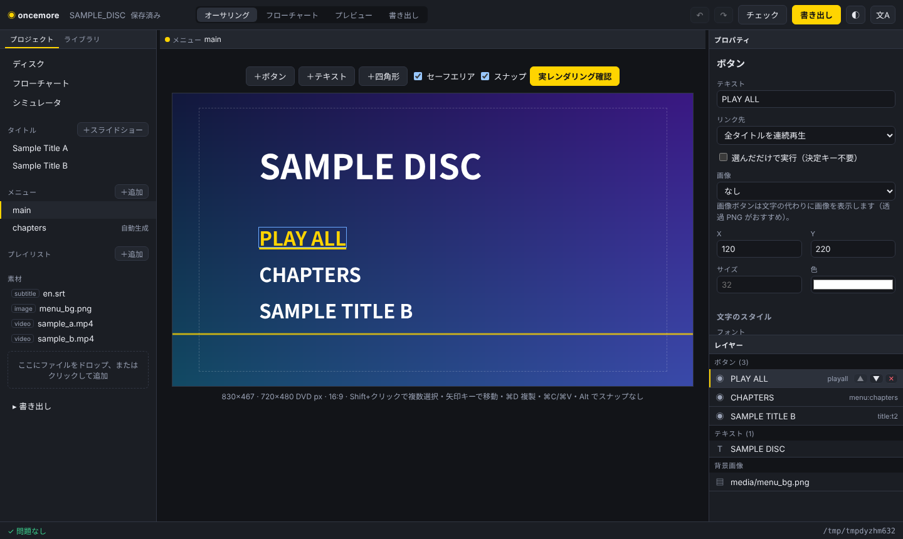
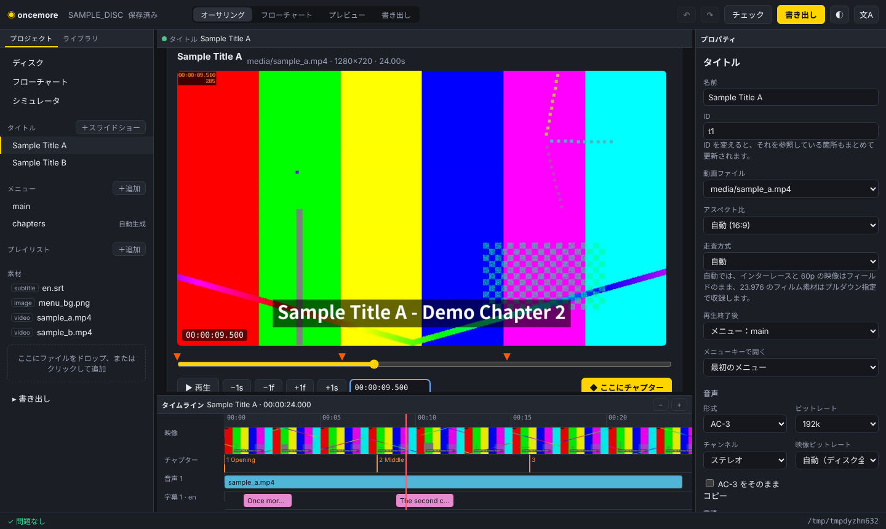
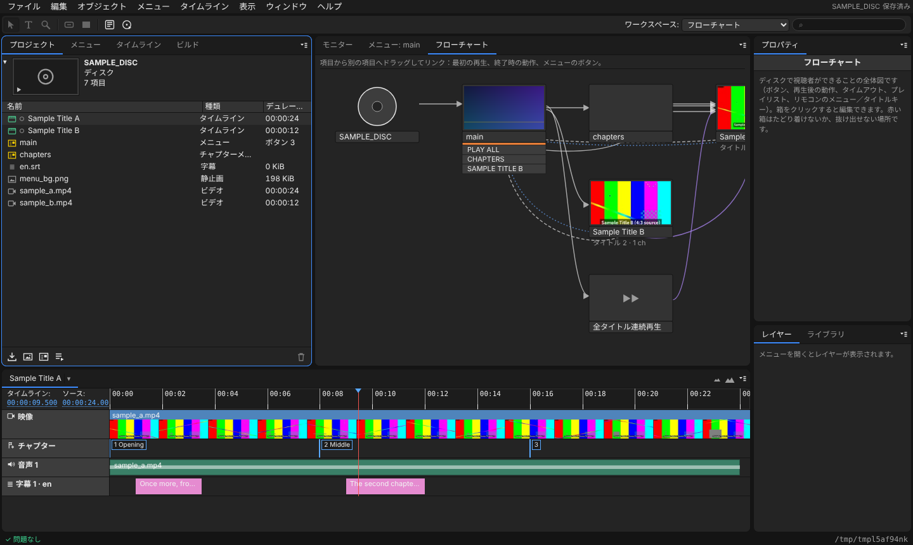
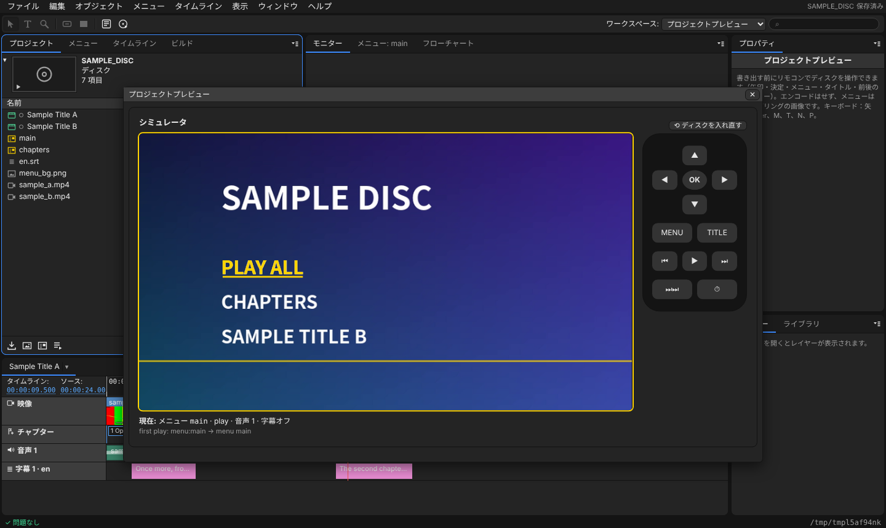

<p></p>

# oncemore

*The DVD authoring app Mac forgot. Menus, chapters, ISO — once more.*

**紹介サイト：[kajisho5.github.io/oncemore](https://kajisho5.github.io/oncemore/ja/)** · [English README](README.md)

oncemore は、動画ファイルから **メニュー付きの DVD-Video ディスクイメージ** を作るツールです。
ボタン付きの静止メニュー、サムネイル付きチャプターメニューの自動生成、チャプタージャンプ、
「本編が終わったらメニューに戻る」を、JSON ファイル 1 つで記述して `.iso` を書き出します。
できた ISO は VLC で再生・マウント・書き込みができます。

**自分の Mac 上でブラウザから使うオーサリングアプリ**（`oncemore gui`）として動き、
その下にスクリプトからも使えるコマンドライン版があります。アプリは手元のマシンから配信され、
ファイルはどこにもアップロードされません。



## oncemore の約束

oncemore が存在する理由です。テストと CI がそれぞれを守っているので（`tests/test_promises.py`）、
知らないうちに失われることはありません。

* **Mac で動く本格オーサリングアプリ** — Apple シリコンと Intel の Oncemore.app を、変更のたびにビルドして起動確認しています。
* **まずディスクイメージ** — 他に何も入れずに標準的な ISO（UDF + ISO 9660）か VIDEO_TS フォルダを書き出します。
  DVD への書き込みは任意の最後の一手順です（ビルド > 出力：DVD ディスク、または `oncemore burn`）。
* **ブラウザで動く** — アプリは自分のマシンから配信される Web ページなので Linux でも動き、Python 以外のインストールは不要です。
* **オープンで、あなたのもの** — GPL-3.0。アカウント不要、ネットワーク通信なし、テレメトリなし、コピーガードは今後も入れません。
  プロジェクトはただの JSON です。

## 背景

Adobe Encore は 2012 年に開発終了、Apple の DVD Studio Pro と iDVD も無くなり、
Final Cut Pro 10.8 ではディスク書き出し自体が削除されました。DVDStyler の macOS 版は
Intel ビルドのままです。一方、DVD-Video の必須コーデックは特許が切れており
（MPEG-2 は 2018 年、AC-3 は 2017 年）、オープンソースで正面から実装できます。
コピーガードは実装しません（今後も入れません）。

## インストール

oncemore 本体は Python 3.11+ の標準ライブラリのみで動きます。外部プログラムを呼び出します：

| プログラム | 用途 |
|---|---|
| `ffmpeg` / `ffprobe`（`drawtext` フィルタ入り） | MPEG-2/AC-3 エンコード、メニュー描画、解析 |
| `dvdauthor` / `spumux` | DVD-Video 構造（IFO/VOB）、ボタンのハイライト |
| *（不要）* — UDF + ISO 9660 のディスクイメージは oncemore 自身が書き出します。`hdiutil`・`genisoimage`・`mkisofs` を選ぶこともできます | ディスクイメージ |
| *（任意）* `growisofs`（dvd+rw-tools。macOS は標準の `hdiutil` を使用） | DVD への書き込み |

### macOS（Homebrew）

```sh
brew install ffmpeg-full dvdauthor
pip install git+https://github.com/kajisho5/oncemore
oncemore doctor
```

* `ffmpeg` ではなく **`ffmpeg-full`** を入れてください。Homebrew の `ffmpeg` は
  libfreetype なしでビルドされており、メニュー文字に使う `drawtext` フィルタがありません。
  `ffmpeg-full` は keg-only（PATH にリンクされない）ですが、oncemore が
  `$(brew --prefix)/opt/ffmpeg-full/bin` を自動で探します。
* ISO は oncemore 自身が書き出す（UDF 1.02 + ISO 9660）ので、ISO ツールは不要です。
  `--iso-tool hdiutil` で macOS 標準のツールを使うこともできます。

### Debian / Ubuntu

```sh
sudo apt-get install ffmpeg dvdauthor genisoimage
pip install git+https://github.com/kajisho5/oncemore
oncemore doctor
```

インストールせずにチェックアウトから `python -m oncemore ...` でも実行できます。

ツールの場所は `ONCEMORE_FFMPEG`、`ONCEMORE_FFPROBE`、`ONCEMORE_DVDAUTHOR`、
`ONCEMORE_SPUMUX`、`ONCEMORE_GENISOIMAGE`、`ONCEMORE_MKISOFS`、`ONCEMORE_XORRISO`、
メニューのフォントは `ONCEMORE_FONT` で上書きできます。
足りないツールがあれば、何が無いかとインストールコマンドを表示して終了します。

## Mac アプリ

**Oncemore.app** は同じ編集画面を普通の Mac のウィンドウで開くアプリです。ダブルクリックで起動し、
「File › New Project… / Open Project…」でプロジェクトを作成・オープン、次回は前回のプロジェクトを自動で開きます。
Python は同梱しているので、Homebrew で入れるのは映像ツールだけです：

```sh
brew install ffmpeg-full dvdauthor
```

[Releases](https://github.com/kajisho5/oncemore/releases) ページ（または最新の CI 実行の成果物）から
`Oncemore-<version>-arm64.zip`（Apple シリコン用）か `Oncemore-<version>-x86_64.zip`（Intel 用）を
ダウンロードして展開し、*Oncemore.app* を「アプリケーション」に入れてください。まだ公証（notarize）していないため、
初回起動は macOS にブロックされます。「システム設定 › プライバシーとセキュリティ」で **このまま開く** を押すか、
`xattr -dr com.apple.quarantine /Applications/Oncemore.app` を実行してください。
自分でビルドする場合は `macos/build_app.sh`（Xcode コマンドラインツールと `gh` が必要）。Developer ID があれば
`CODESIGN_IDENTITY` と `NOTARIZE=1` で署名・公証済みのアプリを作れます。
タグ `v<version>` を push すると `.github/workflows/release.yml` が両アーキテクチャをビルドし、
それぞれサンプルプロジェクトで起動確認したうえで zip をリリースに添付します
（ファイル冒頭に書いた署名用 secrets を設定すれば署名・公証済みになります）。0.x のバージョンはその場で
プレリリースとして公開、1.0 以降は下書きになります。リリースノートは `docs/release-notes/<タグ>.md` です。
ワークフローを手動で実行（Actions > Release > Run workflow）して `tag` を指定しても同じリリースになり、タグは実行したコミットに作られます。

## クイックスタート：ブラウザでアプリ

```sh
oncemore gui my-disc          # ブラウザで http://127.0.0.1:…/ が開きます
```

* **新しいプロジェクト** →「サンプル付きで作成」で動く見本ディスクを確認できます。
  空で始めた場合は、**動画ファイルをウィンドウにドロップ**します。
* **タイトル**：「素材」で動画を選び「タイトルとして追加」。スクラブして、チャプターを切りたい位置で
  **◆ ここにチャプター**。**▶ 再生**で再生できます（初回にプレビュー用の軽いコピーを作ります）。
  「サムネイル付きチャプターメニューを自動生成」にチェックするとチャプターメニューができます。
  再生終了後の動作・音声トラック・字幕（`.srt`・`.vtt`・`.ass`）は右のパネルで設定します。
  タイムラインの下の**字幕の編集**で、各字幕の開始・終了・本文・上下の位置を編集できます。
  「＋再生位置に字幕を追加」で今の位置から新しい字幕を作れます。他形式のファイルは新しい `.srt` として保存して編集します。
* **＋スライドショー**で「素材」の写真からタイトルを作れます。写真ごとの表示秒数と順番、クロスフェードかカット、
  ゆっくりズーム（パン＆ズーム）、BGM を設定し、**書き出して再生**でディスクと同じ見え方を確認できます。
  写真ごとにチャプターになります。
* **クリップ**：タイトルの映像の下の「クリップを追加…」で、別の動画や静止画を同じタイトルにつなげられます。
  ファイルの一部（イン／アウト）を好きな順番で、サイズ・フレームレート・音声（なしでも可）が違っていてもかまいません。
  静止画は表示秒数と、全体を表示（周囲に帯）か画面いっぱい（端を切り抜き）かを選べます。
  タイトルではつないだ結果を表示・再生でき、タイムラインに各クリップが並びます。
  チャプターを指定しなければクリップごとにチャプターになります。
* **メニュー**：「＋追加」で白紙かテンプレート（クラシック・バナー・ミニマル・設定）から作り、ボタン・テキスト・
  四角形をドラッグで配置。Shift+クリックで複数選択して整列・等間隔配置、スナップのガイド、矢印キーでの微調整、
  ⌘D で複製ができます。各ボタンのリンク先
  （メニュー・タイトル・チャプター・音声/字幕の切替）を選びます。ボタンは文字の代わりに画像にもできます
  （「画像」。ハイライトは枠か画像の形）。背景には画像か動画を使えます。
  **実レンダリング確認**で、ディスクで実際に表示される見た目とボタンの当たり判定を確認できます。
* タイトルやメニューの順番は右パネルの ▲/▼ で変えられます。
* **バックアップ**：プロジェクトファイルを上書きする前に、それまでの版をプロジェクトの隣の `.oncemore-backup/` に残します
  （最大 5 分ごと、直近 30 版）。**ファイル > 保存済みの版に戻す**で戻せ、取り消すで今の状態に戻れます。
* **レイヤー**：目のアイコンで要素を非表示にできます（プロジェクトには残り、ディスクには入りません。ボタンへのルートも外れます）。
* **メニューをテンプレートとして保存**（メニューメニュー）：メニューと、使っている画像・フォント・BGM のコピーをテンプレートライブラリ
  （`ONCEMORE_TEMPLATES`、Mac では `~/Library/Application Support/oncemore/templates`）に保存し、ライブラリの**マイテンプレート**から
  どのプロジェクトでもメニューを作れます（そのプロジェクトにないリンク先は *stop* になります）。**チャプターインデックスを作成**で
  タイトルのチャプターメニューを作ります。
* **カラーセット**（メニューのプロパティ）：通常時（選択されていないボタン・任意）、選択中、決定時の色と、それぞれの不透明度。
  プレビューとシミュレータでもプレーヤーと同じように表示します。
* **ファイルのチャプターマーカー**：チャプターマーカー付きの動画（MP4・MOV・MKV など）は、タイトルにすると名前ごとチャプターになります。タイムライン > ソースのチャプターマーカーを読み込む で読み直せます（クリップをつないだタイトルでは各クリップ内のマーカー）。
* **一定間隔でチャプター**（タイムラインメニュー）：*n* 分／秒ごとにチャプターを置きます（今のチャプターを置き換えるか、追加するか）。
* **アセットを置き換え**（ファイルメニュー、またはファイルを右クリック）：プロジェクト内で使われているファイルを別のファイルに
  まとめて差し替えます。見つからなくなったファイルの付け直しもこれで行います（見つからないファイルが先頭に並び、問題一覧からも開けます）。
* **Photoshop でメニューを編集**（編集メニュー、ツールパネル、プロパティ）：メニューの `.psd` を開き、Photoshop で保存されると
  メニュービューアに「読み込み直す」が出ます。**ファイル > プロジェクト設定**でディスクの設定、**ウィンドウ**メニューで各パネルを前面に。
* **今すぐトランスコード**：タイトルはディスクの書き出し時にエンコードされますが、右クリックまたは「ディスク」メニューの
  「このタイトルを今すぐトランスコード」「すべてのタイトルを今すぐトランスコード」で先に済ませておけます（書き出し時に再利用）。
  プロジェクトパネルのタイトル名の前の丸が塗りつぶされていればトランスコード済みです。タイムラインには各音声トラックの波形が出ます。
* **リンクとルーティング**：プロジェクトパネルのタイトル・メニュー・プレイリストをボタンにドラッグするとリンクでき、
  メニューの空いた所にドラッグするとそのボタンを追加します。「ルーティング」をオンにすると、各ボタンからリモコンの
  矢印キーで移る先を矢印で表示します（実線：プロパティで指定、破線：自動）。ディスクと同じ計算結果です。
* **メニューとショートカット**：メニューバーはディスクオーサリングでおなじみの並び（ファイル・編集・オブジェクト・メニュー・
  タイムライン・表示・ウィンドウ・ヘルプ）で、サブメニュー（読み込み、トランスコード、ビルド、整列、重ね順、ハイライトを表示、
  ワークスペースなど）もあります。Oncemore.app では同じ内容から作った Mac 本来のメニューバーです。ファイルではプロジェクトを
  開く・作る・保存する（最近使用したプロジェクト、別名で保存はプロジェクトのフォルダーごとコピー）、ファイルをメニュー・
  タイムライン・スライドショー・ポップアップメニューとして読み込む、DVD／Blu-ray のイメージ・フォルダー・ディスクを
  ビルドする。編集ではオブジェクトやタイトル・メニューごとのカット・コピー・ペースト、名前の変更、オリジナルの編集。
  オブジェクトでは整列（1 つだけならセーフエリアに）、分布、重ね順、ドロップシャドウと境界線。メニューではオブジェクトの追加、
  デフォルトのボタン、カラーセット、メニューを画像として保存。タイムラインではオーディオ／字幕トラックの追加、テキスト
  スクリプトの読み込み（絶対／相対タイムコード）、字幕の SubRip またはテキストスクリプトでの書き出し、ポスターフレーム、フレームの保存（書き出しは `exports/` に入ります）。タイトル・メニュー・プレイリスト
  （開く、複製、移動、ディスクの最初に再生、トランスコード、削除）、「素材」のファイル、メニュー上の要素は右クリックでも操作できます。
  ショートカット：⌘N／⌘O／⌘S／⇧⌘S 新規・開く・保存・別名で保存、⌘I 読み込み、⌘B 書き出し、⌘X／⌘C／⌘V／⌘D
  カット・コピー・ペースト・複製、⌘A すべてを選択、⌘Z／⇧⌘Z 取り消し／やり直し、⌘[／⌘]／⇧⌘[／⇧⌘] 重ね順、
  ⌘0 ウインドウに合わせる、⌘L 選択中のボタンのリンク、
  V／R／T／Z 選択・回転・テキスト・ズームツール、⌘;／⌥⌘;／⇧⌘; ガイドの表示・ロック・スナップ、+／− 拡大縮小、`*`（Shift+8）再生位置にチャプター、PgUp／PgDn 前後のチャプター、
  Space 再生／一時停止、⇧Space プレビュー、⌥⇧1〜4 ワークスペース、? 一覧（Mac 以外は ⌘ の代わりに Ctrl）。
* **メニューエディタ**：左にツール（選択、回転＝オブジェクトを中心のまわりにドラッグ、テキスト＝置きたい場所をクリック、ズーム、
  ボタン／四角形の追加、プレビュー）、メニューの下にビューアバー（表示倍率、セーフエリア、ルーティング、スナップ、ガイドと「新規ガイド」、
  「ハイライト：通常／選択中／決定時」＝全ボタンをその状態でディスクと同じ画で表示）があります。範囲が重なったボタンは赤枠で示します。
  オブジェクト > 回転／反転で、テキスト・ボタン・四角形・画像を回したり反転したりできます（ディスク上でもハイライトごと回ります）。
* **ピックウィップ**：ボタンのリンク（タイトルの終了時の動作、ディスクの最初の再生も）の横の ◎ を、プロジェクトパネルか
  フローチャートのタイトル・メニュー・プレイリストまでドラッグするとリンクできます。**フローチャート**では項目から別の項目へ
  ドラッグしてリンク（最初の再生、終了時の動作、メニューならボタンを選んで）。どこからも使われない項目は下の「未使用」の段に並びます。
* **プレビュー**（⇧Space）は編集中のメニューからリモコン操作のプレビューを始めます。プレビュー中は 1〜9 でそのボタン、
  Home が Title キー、Insert が Menu キー、End で最後まで再生します。
* **フローチャート**でディスク全体（ディスク挿入時、メニュー、タイトル、プレイリストと、それらをつなぐボタン・
  再生後の動作・タイムアウト・リモコンのメニュー／タイトルキー）を一望できます。視聴者がたどり着けない箱や、
  抜け出せないメニューは赤枠で表示されます。箱をクリックすると編集できます。
* **シミュレータ**では、書き出す前に画面上のリモコン（矢印・決定・メニュー・タイトル・⏮ ⏭・最後まで再生・
  メニューのタイムアウト）でディスクを操作できます。メニューは実レンダリング画像と実際のハイライト、
  タイトルはチャプター先頭のフレームで表示します。完成ディスクと同じナビゲーション規則で動きます
  （テストで libdvdnav と照合しています）。
* **ビルド**パネル（プロジェクトの隣）：**プロジェクトをチェック…**で容量の見積もりと問題点の確認、
  **ビルド**で `my-disc/output/` に `.iso`（または VIDEO_TS フォルダ）を進捗表示付きで書き出します。
* 編集は `my-disc/project.oncemore.json` に自動保存され、⌘Z / Ctrl+Z で元に戻せます。
  表示言語はブラウザに合わせて英語/日本語（編集 > 環境設定で切替。明るさ・ライトテーマもここ）。



ワークスペースは定番のディスクオーサリングの構成です：メニューバー、**ツール**パネル（選択・テキスト・ズーム・
ボタン／長方形の追加・Photoshop・プレビュー）と**ワークスペース**メニュー・検索欄、左に**プロジェクト・メニュー・
タイムライン・ビルド**、中央に**モニター・メニュービューア・フローチャート**、その下を横断する**タイムライン**、
右に**プロパティ**と**ライブラリ・レイヤー**。スキンは 2 種類（編集 > 環境設定）：標準の**モダン**と、
中間グレーのパネル・明るい入力欄・作業中のパネルの琥珀色の枠・琥珀色のタイムコードの**クラシック**。
パネルの境目をドラッグして大きさを変えられます。デザインの決まりは
[docs/DESIGN.md](docs/DESIGN.md)、アプリでは `/styleguide.html` で確認できます。




アプリは 127.0.0.1 でのみ待ち受け、起動ごとのランダムなキーを URL に含めます。
読み書きするのはプロジェクトフォルダ内のファイルだけです。

## クイックスタート：コマンドライン

```sh
oncemore init demo                                   # サンプルプロジェクト＋テスト素材を生成
oncemore preview-menu demo --menu main -o main.png   # メニューの見た目を確認
oncemore iso demo/project.oncemore.json -o demo.iso  # エンコード→オーサリング→ISO
```

サンプルには、メインメニュー（PLAY ALL / CHAPTERS / SAMPLE TITLE B）、サムネイル付きの
自動チャプターメニュー、3 チャプターの 16:9 タイトル、4:3 のタイトル（ピラーボックス）が
入っています。素材はすべて ffmpeg のテストソースで生成するので、リポジトリに大きな
バイナリは含みません。

## コマンド

```
oncemore init <dir> [--standard NTSC|PAL] [--aspect 16:9|4:3] [--force]
oncemore validate <project> [--no-media]       # スキーマ＋参照＋素材＋容量見積もり
oncemore build <project> -o out/               # out/VIDEO_TS（と out/AUDIO_TS）を生成
oncemore build <project> -o out/ --format bluray  # out/BDMV（Blu-ray、HD）を生成
oncemore iso <project> -o bd.iso --format bluray   # Blu-ray のディスクイメージ（UDF 2.50、内蔵ライター）
oncemore iso <project> -o out.iso [--iso-tool auto|builtin|hdiutil|genisoimage|mkisofs|xorriso]
oncemore preview-menu <project> --menu main -o main.png [--button id] [--state highlight|select|normal] [--outline]
oncemore simulate <project> --keys down,enter,menu   # リモコン操作を再現（エンコードなし）
oncemore import-psd <project> design.psd --menu main [--first-play]   # Photoshop からメニューを作成
oncemore gui [<dir>] [--port N] [--no-browser] # オーサリングアプリ
oncemore transcode <project> [--title ID] [--fast] [--status]  # 書き出し前にタイトルをエンコード
oncemore burn out.iso [--device DEV]           # イメージを空の DVD に書き込み（macOS は hdiutil、他は growisofs）
oncemore clean <プロジェクト>                   # エンコードキャッシュを削除（次のビルドで作り直し）
oncemore doctor                                # 外部ツールの有無・バージョン・ISO バックエンド
oncemore mcp [--root DIR]                      # AI アシスタント向けのツール（MCP、下記）
```

* `<project>` は `project.oncemore.json` かそれを含むディレクトリ。
* `validate` はナビゲーションも確認します。どこからも行けないタイトル・メニュー・プレイリストや、
  抜け出せないメニューは警告になります（`--json` では `navigation`）。
* `build` / `iso` は既定で **2 パス**エンコード。`--fast` で 1 パス。
* 中間ファイルは `out/.work/`（`iso` では ISO の隣の隠しビルドディレクトリ）に置き、
  `--keep-work` が無ければ成功時に削除します。各外部コマンドのログは `.work/logs/`。
* `--json`（コマンドの前後どちらでも可）で stdout が **JSON Lines** になります（GUI 連携用）：
  `step`、`progress`（`fraction` 0〜1）、`log`、最後に `result` か `error`。
  終了コード：0 成功、1 エラー、2 プロジェクト不正、3 ツール不足、4 外部ツール失敗。

## AI アシスタントから使う（MCP）

`oncemore mcp` を使うと、AI アシスタントにディスク作りを任せられます。oncemore の操作を
[Model Context Protocol](https://modelcontextprotocol.io) のツールとして stdio で提供するので、
「この動画 3 本で、黒地に白文字のチャプターメニュー付き DVD を作って」と頼めば、アシスタントが
プロジェクトを作り、動画を取り込み、メニューを書き、チェックし、メニューを画像で見せ、
リモコン操作を試し、ディスクイメージまでビルドします。

Claude Code：

```
claude mcp add --scope user oncemore -- oncemore mcp
```

Claude Desktop（`claude_desktop_config.json`）などの MCP クライアント：

```json
{"mcpServers": {"oncemore": {"command": "oncemore", "args": ["mcp"]}}}
```

ツール：`project_format`（JSON Schema）、`create_project`、`read_project`、`write_project`、
`edit_project`（JSON Merge Patch）、`import_media`、`validate`、`preview_menu`（PNG）、`simulate`、
`import_psd`、`build` と `build_status`（バックグラウンドで実行。DVD／Blu-ray のイメージかフォルダーを
`<project>/output` に作成）、`doctor`。不正になるプロジェクトは書き込まず、問題点をアシスタントに返して
直してもらいます。触るのはホームフォルダーの中だけです（`--root DIR` を繰り返して広げたり絞ったりできます）。
接続したアシスタントを通す以外に、データがパソコンの外に出ることはありません。プロトコルは
2026-07-28 版と、`initialize` で始まるそれ以前の版の両方に対応します。

## プロジェクトファイル

入力は `project.oncemore.json` だけです。JSON Schema：
[schema/project.schema.json](schema/project.schema.json)。パスはプロジェクトファイルからの
相対パス。例：[examples/basic/project.oncemore.json](examples/basic/project.oncemore.json)。

```jsonc
{
  "version": 1,
  "disc": {
    "label": "SAMPLE_DISC",      // ボリュームラベル。A-Z 0-9 _ の 32 字以内に正規化
    "standard": "NTSC",          // NTSC（720x480, 29.97）| PAL（720x576, 25）
    "aspect": "16:9",            // 4:3 | 16:9
    "target": "DVD5",            // DVD5（4.37 GiB）| DVD9（7.95 GiB）
    "first_play": "menu:main",   // menu:<id> | title:<id> | playall。既定は最初のメニュー
    "font": null,                // メニュー文字のフォント。null で自動検出
    "video_bitrate": "auto"      // "auto" で容量に合わせて自動。固定なら "6M" など
  },
  "titles": [
    {
      "id": "t1",
      "name": "Sample Title A",                     // チャプターメニューの見出し
      "source": "media/sample_a.mp4",
      "chapters": ["00:00:00", "00:00:08", 16],     // "HH:MM:SS[.ms]"、"MM:SS"、秒数
      "audio": { "codec": "ac3", "bitrate": "192k" },// ac3 | lpcm（48kHz/16bit）| dts（コピー）。"channels": 6 で 5.1ch
      "end_action": "menu:main",                    // menu:<id> | title:<id> | stop
      "auto_chapter_menu": { "id": "chapters", "back": "menu:main" }  // または true
    }
  ],
  "menus": [
    {
      "id": "main",
      "background": "media/menu_bg.png",   // 静止画。null なら background_color
      "audio": null,                       // 任意。ループ BGM
      "texts": [{ "text": "SAMPLE DISC", "x": 120, "y": 90, "size": 56 }],
      "buttons": [
        { "id": "play", "label": "PLAY ALL", "x": 120, "y": 220, "action": "playall" },
        { "id": "ch",   "label": "CHAPTERS", "x": 120, "y": 280, "action": "menu:chapters" }
      ],
      "highlight_color": "#FFD400",
      "select_color": "#FF5A00"
    }
  ]
}
```

### リファレンス

**disc**

| キー | 型・値 | 既定値 |
|---|---|---|
| `label` | 文字列 → A–Z 0–9 `_`、32 字以内 | 必須 |
| `standard` | `NTSC` \| `PAL` | 必須 |
| `aspect` | `4:3` \| `16:9` | 必須 |
| `target` | `DVD5` \| `DVD9` | `DVD5` |
| `first_play` | `menu:<id>` \| `title:<id>` \| `playall` | 最初のメニュー、無ければ最初のタイトル |
| `title_key` | リモコンのタイトル／トップメニューキーで開くもの：`menu:<id>` \| `title:<id>` \| `playall` | 最初のメニュー |
| `font` | パス または `null` | 自動：ヒラギノ（macOS）→ Noto Sans CJK → DejaVu Sans |
| `video_bitrate` | `"auto"` かビットレート（`"6M"`、`5500000`）、1〜8 Mbps | `auto` |
| `rom_files` | VIDEO_TS と並べて入れるファイル／フォルダ（パソコン向けの DVD-ROM コンテンツ） | なし |
| `bluray.target` | `BD25` \| `BD50`：Blu-ray としてビルドするときのディスク容量 | `BD25` |
| `subtitle_style` | 全字幕の `{size, color, outline, outline_width, margin}` | 30px（PAL 36）、白、黒縁 3px、下から 36px（PAL 43） |

**titles[]**（1〜99）

| キー | 型・値 | 既定値 |
|---|---|---|
| `id` | `[A-Za-z0-9_-]{1,40}` | 必須 |
| `name` | 文字列 | id |
| `source` | ffmpeg が読める動画 | 必須（または `slideshow`／`clips`） |
| `slideshow` | 写真から作るタイトル（下記） | なし |
| `clips` | 複数の動画の一部をつないだタイトル（下記） | なし |
| `chapters` | 時刻のリスト、または `{time, name, poster}`（`name` はチャプターメニューのボタン名、`poster` はサムネイルにする時刻）。0 が無ければ自動追加 | `[0]` |
| `audio.codec` | `ac3` \| `lpcm` \| `dts`（48kHz の DTS 素材をそのままコピー。エンコードはしない。`channels` で 2 を指定しなければ 5.1ch。DTS-HD 素材は DTS コア部分。DVD は 1536k まで） | `ac3` |
| `audio.bitrate` | AC-3 のみ、64k〜448k | `192k`（5.1ch は `448k`） |
| `audio.passthrough` | 48kHz の AC-3 素材をそのままコピー（チャンネル数は素材と同じに） | `false` |
| `scan` | `auto` \| `progressive` \| `interlaced` \| `pulldown`（NTSC のフィルム）\| `ivtc`（NTSC：29.97i にテレシネ済みのフィルム。逆テレシネでフィルムのコマに戻し、ソフトプルダウンで収録）：映像の収録方式。「既知の制限」参照 | `auto` |
| `picture` | `source` が音声ファイル（音楽）のとき、タイトルの間ずっと表示する静止画。指定しなければ黒画面 | なし |
| `transcode` | `false`：素材がすでに DVD ビデオ（ディスクと同じフレームサイズ・フレームレート〈NTSC は 23.976 のフィルムも可〉・縦横比の MPEG-2、9.8 Mbit/s 以下）なら映像を再エンコードせずそのまま収録。音声はタイトルの設定で作り直し、チャプターは指定時刻ちょうどではなく素材のキーフレーム（GOP の先頭）から始まります。Blu-ray では同じ設定で、すでに Blu-ray ビデオになっている H.264（High または Main プロファイル・レベル 4.1 以下、1920x1080・4:2:0・正方形ピクセル、23.976 のプログレッシブ、または 25 / 29.97 をフィールド符号化した 1080i、キーフレームが 1 秒以内ごと、40 Mbit/s 以下）を再エンコードせずに収録します。条件を満たさない映像は理由を警告に出してエンコードします | `true` |
| `video_bitrate` | このタイトル専用の映像ビットレート。残りを他のタイトルで分け合う | 共有 |
| `audio.channels` | `2`（ステレオ。素材はダウンミックス）\| `6`（5.1ch、AC-3 のみ） | `2` |
| `end_action` | `menu:<id>` \| `title:<id>` \| `chapter:<タイトルid>:<番号>` \| `playlist:<id>` \| `playall` \| `lastmenu`（直前に表示したメニューへ戻る） \| `stop` | first_play のメニュー、無ければ `stop` |
| `remote_menu` | このタイトルの再生中にリモコンのメニューキーで開くメニュー | 最初のメニュー |
| `prohibit` | このタイトルの再生中は効かないリモコン操作（ユーザー操作）。例：飛ばせない注意書き `["next", "fast_forward", "menu"]`。指定できるのは `next` `prev`（チャプター送り・戻し）、`fast_forward` `rewind`、`pause`、`stop`、`search`（数字キー：タイトル・チャプター・時間の検索）、`menu`（メニュー／ポップアップキー）、`title`（タイトル／トップメニューキー）、`audio`、`subtitle` | なし |
| `aspect` | このタイトルの `4:3` \| `16:9` | `disc.aspect` |
| `audio.lang` | 音声（1 トラック時）の ISO 639-1 言語コード | なし |
| `audio_tracks` | 1〜8 個の `{source?, stream?, lang?}`：複数音声（下記） | `source` の音声 1 本 |
| `subtitles` | 32 個までの `{file, lang?, default?}` SRT ファイル（下記） | なし |
| `auto_chapter_menu` | `true` またはオブジェクト（下記） | なし |

`auto_chapter_menu` のオブジェクト：`id`（既定 `chapters_<タイトルid>`、2 ページ目以降は
`_2`、`_3`…）、`title`（見出し）、`back`（BACK ボタンのアクション。既定は first_play のメニュー）、
`label_format`（既定 `"Chapter {n}"`）、`back_label`、`prev_label`、`next_label`、
`background`、`background_color`、`text_color`、`highlight_color`、`select_color`、`normal_color`、
`audio`、`duration`、`background_video`（動くチャプターメニュー）、`animated_thumbnails`
（動く背景のとき、サムネイルでそのチャプターを再生）。1 ページ 6 チャプターで、超えると PREV/NEXT ボタンが付きます。

**menus[]**（99 以内）

| キー | 型・値 | 既定値 |
|---|---|---|
| `id` | 識別子 | 必須 |
| `background` | 静止画 または `null` | `null` |
| `background_color` | `#RRGGBB` | `#000000` |
| `background_video` | **モーションメニュー**用の動画（`background` より優先） | `null` |
| `audio` | 音楽ファイル または `null` | 背景動画の音、無ければ無音 |
| `duration` | ループの長さ（秒） | 動画／BGM の長さ（600 以下）、無ければ 5 |
| `loop` | `"forever"` か、`end_action` までに再生する回数 | `forever` |
| `loop_point` | 2 回目以降の再生開始位置（時間）。それより前はイントロとして 1 回だけ再生 | `0` |
| `fade_in` | メニュー開始時に黒からフェードインする秒数（映像と音声、最大 10）。1 回だけ再生し、繰り返しはその後から | `0` |
| `buttons_at_loop` | ボタンを繰り返しの開始位置（またはフェードインの終わり）から表示・操作可能に。イントロは最後まで再生 | `false` |
| `end_action` | 最後の再生のあと：`menu:` \| `title:` \| `chapter:` \| `playall` \| `stop` | `stop` |
| `default_button` | メニューを開いたときに選ばれているボタンの id | 先頭 |
| `remember_button` | 戻ってきたとき前に使ったボタンを選ぶ（メニュー 1〜7） | `true` |
| `button_offset` | リモコンの数字キー用に、ボタンの番号（並び順 1, 2, …）へ足す値。10 なら最初のボタンは 11（プロパティの「番号」でボタンの番号を付け直せます） | `0` |
| `prohibit` | このメニューの表示中は効かないリモコン操作（タイトルと同じ） | なし |
| `font_size`、`text_color` | テキスト・ボタンの既定値 | `32`、`#FFFFFF` |
| `highlight_color`、`select_color` | 選択中／決定時のボタンの色。`#RRGGBBAA` で半透明（DVD の不透明度は 16 段階） | `#FFD400`、`#FF5A00` |
| `hidden`（ボタン・テキスト・長方形・画像） | レイヤーパネルで非表示：プロジェクトには残り、ディスクには入らない | `false` |
| `rotate`、`flip`（ボタン・テキスト・長方形・画像） | オブジェクトの中心を軸に時計回りに回す角度と、先に反転する向き `horizontal` / `vertical` / `both`（オブジェクト > 回転 / 反転、回転ツール）。ボタンのラベルや画像はハイライトと一緒に回り、サムネイルはそのまま | `0`、なし |
| `guides` | `{horizontal: [y…], vertical: [x…]}` オブジェクトを配置するためのガイド（表示 > 新規ガイド。エディタでドラッグ。Photoshop ファイルのガイドも読み込み）。メニューと一緒に保存され、ディスクには出ない | なし |
| `normal_color` | 選択されていないボタンのハイライト形状の色（カラーセットの通常時）。無指定なら表示しない | — |
| `texts[]` | `{text, x, y, size?, color?}` 装飾テキスト（下の文字スタイルも指定可） | `[]` |
| `shapes[]` | `{x, y, w, h, color}` 塗りつぶしの四角形（帯やパネル。`#RRGGBBAA` で半透明）。テキストとボタンの下に描画 | `[]` |
| `images[]` | `{file, x, y, w, h, opacity}` ボタンではない画像（ロゴ・写真。PNG は透明部分を保持）。四角形の上、テキストとボタンの下に描画。アプリでは ツール > 画像、または画像を右クリック > メニューに配置 | `[]` |

文字スタイル（テキストと文字ボタン）：`font`（この要素用のフォントファイル。全文字を含む必要あり）、
`outline` と `outline_width`（縁取り）、`shadow` と `shadow_offset`（影）。ボタンの `highlight_image` は、
選択時に不透明部分が光る画像で、自動のハイライトの代わりに使われます。
| `buttons[]` | 1〜36 個 | 必須 |

**buttons[]**：`id`、`label`、`x`、`y`（ラベルの左上）、`action`、
`auto_activate`（選んだだけで実行）、
（`menu:<id>` \| `title:<id>` \| `chapter:<タイトルid>:<番号>` \| `playall` \| `audio:<n>` \|
`subtitle:<n>` \| `subtitle:off` \| `resume` \| `stop`）、任意で `size`、`color`、自動ナビゲーションを
上書きする `nav`（`{"up": id, "down": id, "left": id, "right": id}`）。
`audio:<n>` / `subtitle:<n>`（1 始まり）はストリームを切り替えてメニューに留まるので、
「音声・字幕設定」メニューはこれらのボタンと BACK ボタンを並べるだけで作れます。
`playall` は全タイトルをプロジェクトの順に再生し、最後のタイトルの `end_action` に従います。
タイトル／チャプターボタンから単独で再生したタイトルは、そのタイトル自身の `end_action` で終わります。
`resume` はリモコンのメニュー／タイトルキーで中断したタイトルを、中断した位置から再開します。
再開するものが無いとき（ディスクの再生開始直後や、タイトルが最後まで再生された後）は最初のタイトルを再生します。
メニューを開くアクション（ボタン、終了時アクション、`override`、`first_play`、タイトルキー）では、
`menu:<id>:<ボタンid>` と書くと、既定のボタンや前回のボタンではなく、そのボタンを選んだ状態でメニューが開きます。
たとえば BACK ボタンで、来たときのボタンを選んだままメインメニューに戻したり、
タイトルの終了時に「次の話」のボタンを選んだメインメニューに戻したりできます。
`title:` / `chapter:` のボタンに `override`（終了時アクションと同じ指定）を付けると、
そのボタンから再生したときに限り、タイトルの終了時アクションを置き換えます。
タイトル同士を連続再生でつなぎつつ、曲ごとのボタンからはメニューに戻る、といった構成ができます。
ボタンの `audio`（1 始まり）と `subtitle`（1 始まり、`0` でオフ）は、リンク先へ移るのと同時に
ストリームを切り替えます。例：「コメンタリー付きで再生」ボタン
`{"action": "title:film", "audio": 2, "subtitle": 0}`。
リンク先のあるボタン（メニュー、タイトル、チャプター、プレイリスト、すべて再生）に `transition`（ビデオファイル）を付けると
**リンクトランジション**になります。ボタンを押すとそのビデオを再生してから、ボタン本来のリンク先へ進みます。
たとえばメインメニューがシーン選択メニューへ溶けていく映像（動画編集ソフトで短いクリップとして書き出したもの）を挟めます。
DVD ではメニュー領域の独立したプログラムとして、Blu-ray では独立したタイトルとして再生されます。
同じビデオで同じリンク先のボタンは 1 つのコピーを共有します。
**画像ボタン**：`image`（画像。透過 PNG がおすすめ）を指定するとラベルの代わりに画像を `x`/`y` を左上として
表示します（このとき `label` は省略可）。`width` は 720 幅の座標での幅（既定は画像の元の幅。高さは縦横比に従う）、
`highlight` は `frame`（既定。周りに枠）か `shape`（画像の不透明部分をハイライト色で表示）。

### Photoshop からのメニュー

レイヤー付きの `.psd` / `.psb`（RGB、8 / 16 bit）でメニューをデザインし、**メニュー → ＋追加 → Photoshop から読み込み**
（または `oncemore import-psd`）で取り込めます。レイヤー名は DVD メニューで昔から使われている接頭辞です。

| レイヤー名 | 意味 |
|---|---|
| `(+) Play Movie` | ボタンになる**グループ**。名前が id になり、リンク先の推測にも使います |
| ボタン内の `(=1) …` | ハイライト（`(=2)`、`(=3)` も可。ここでの DVD ハイライトは 1 色なので統合します） |
| ボタン内の `(%) …` | タイトル／チャプターのサムネイルを置く位置 |
| それ以外の表示中のレイヤー | アートワーク（背景に統合） |

* `(=n)` と `(%)` のレイヤーを非表示にして保存すると、ファイル自身の統合画像をそのまま背景に使います
  （レイヤー効果も含めて正確。「互換性を優先」で保存してください）。表示されている場合はレイヤーから通常合成で作り直します。
* `(=1)` レイヤーの無いボタンは、ボタン自体の絵の形で光ります。
* *Play*、*Play all*、*Scene 3*、タイトル名、メニュー id、*Audio 2*、*Subtitles off* などの名前は自動でリンクします。それ以外は確認してください。
* 720 × 480（576）のデザインは DVD のピクセル、854 × 480 や 1024 × 576 は正方形ピクセルとして読みます。どちらも描いた位置に収まります。
* ファイルを編集した後は**読み込み直す**で、画像を更新しつつボタンのリンク先とメニューの設定を残します。

取り込んだボタンは `highlight_image` だけを持つ普通のボタンです（`thumbnail` の矩形はタイトル／チャプターのボタンならどれにも付けられます）。

### プレイリスト

```jsonc
"playlists": [{
  "id": "best", "name": "名場面集",
  "items": ["t1:2", "t2:2-3", "t1"],   // チャプター 1 つ、チャプター範囲、タイトル全体
  "end_action": "menu:main"            // タイトルの終了時アクションと同じ。既定は stop
}]
```

`"action": "playlist:best"` のボタン（または `first_play` / `title_key`）で、項目を順に再生します。
形式の違うタイトルをまたいでも構いません。各項目は最後のチャプターの終わりで止まり、次へ進みます。
タイトル・チャプター・全タイトル連続再生のボタンを押すとプレイリスト再生は解除されます。

### スライドショー

```jsonc
"titles": [{
  "id": "holiday", "name": "旅行",
  "slideshow": {
    "slides": [{ "image": "media/beach.jpg", "duration": 6 },   // 秒。既定 5
               { "image": "media/hills.png" }],
    "transition": "crossfade",        // dissolve・fadeblack・fadewhite・wipeleft/right/up/down・
                                      // slideleft/right/up/down・circleopen/close・radial・
                                      // pixelize・random、"none" でカット。写真ごとの
                                      // "transition" で次の写真への切り替えを個別に指定
    "transition_duration": 1,         // 秒。どの写真の表示時間よりも短く
    "pan_zoom": true,                 // 写真ごとにゆっくりズームイン／アウト
    "fit": "fill",                    // 画面いっぱい（端を切り抜き）。既定は "fit"
    "audio": "media/music.m4a",       // 長さに合わせて切り、最後はフェードアウト。
                                      // リストにすると順番に続けて再生
    "fit_to_audio": false,            // true で写真の秒数を比率として BGM の長さに合わせる
    "advance": "auto",                // "manual" で次へ／再生を押すまで各写真を表示（カットのみ・BGM なし）
    "background_color": "#000000"     // 縦横比の違う写真の余白の色
  },
  "end_action": "menu:main"
}]
```

写真はディスクの正方形ピクセルの画面（NTSC 16:9 なら 854 × 480）に収めて、
`.oncemore-cache/slideshow` に一度だけ可逆圧縮の動画として書き出し、それを普通のタイトルと同じようにエンコードします
（写真・秒数・設定を変えたときだけ書き出し直します）。*k* 枚目は前の写真の秒数の合計から始まり、
`chapters` を指定しなければそこがチャプターになります。`fit` は縦横比の違う写真の扱いで、`fit` は全体を表示して
周囲を背景色に、`fill` は画面いっぱいに広げてはみ出した部分を切り抜きます。写真ごとに `fit` を指定することもできます。
`fit_to_audio` を指定すると、写真の表示時間を比率のまま伸縮して、スライドショーの長さを BGM の長さにぴったり合わせます（チャプターも移動します）。

### クリップをつないだタイトル

```jsonc
"titles": [{
  "id": "evening", "name": "夜の部",
  "clips": [
    { "source": "media/arrival.mov", "in": "00:01:10", "out": "00:03:00" },
    { "source": "media/speech.mp4" },                  // ファイル全体
    { "source": "media/phone.mp4", "out": 42.5 },      // 秒または HH:MM:SS(.mmm)
    { "source": "media/group.jpg", "duration": 6, "fit": "fill" }  // 静止画
  ],
  "end_action": "menu:main"
}]
```

クリップは順番に続けて 1 つのタイトルとして再生されます。つなぐのはタイトルのエンコード時で、
事前の書き出しはありません。クリップごとにディスクの形式へ変換するので、サイズ・フレームレート・
音声の形式が違ってもかまいません。音声のないクリップには無音が入ります。各クリップの長さはフレーム単位に
切り上げるので、つなぎ目で映像と音声がずれません。`chapters` を指定しなければ *k* 番目のクリップの頭がチャプターになります。
すべて 23.976p のフィルムならソフトプルダウン、すべてインターレースならインターレースのまま、混在するとプログレッシブになります。
クリップのタイトルの音声は 1 本です（`audio_tracks` と `audio.passthrough` は使えません）。
メニューのサムネイルやポスターフレームは、その時刻に再生されているクリップから取ります。

静止画（`.png`・`.jpg`・`.jpeg`・`.bmp`・`.tif`・`.tiff`・`.webp`）は `duration` の秒数だけ表示され
（既定 5 秒、0.5 秒〜1 時間。`in`／`out` は使えません）、音声は無音です。`fit`（既定）は全体を表示して
縦横比の違う分を黒い帯に、`fill` は画面いっぱいに広げて端を切り抜きます。

### 複数音声と字幕

```jsonc
"titles": [{
  "id": "t1", "source": "media/movie.mp4",
  "audio": { "codec": "ac3", "bitrate": "192k" },          // 全トラック共通
  "audio_tracks": [
    { "lang": "ja" },                                       // source の音声ストリーム 0
    { "source": "media/commentary.wav", "lang": "en" },     // 別ファイル
    { "stream": 1, "lang": "fr" }                           // source の 2 本目の音声
  ],
  "subtitles": [
    { "file": "media/ja.srt", "lang": "ja", "default": true },
    { "file": "media/en.srt", "lang": "en" }
  ]
}]
```

* 各トラックは映像の長さに合わせて無音で埋める／切り詰めます。存在しないストリームは `validate` が報告します。
* DVD はストリーム属性を titleset 単位で持つため、n 番目のストリームの言語はディスク全体で 1 つです
  （タイトル間で `lang` を揃える必要があります）。
* 字幕は SubRip（`.srt`）、WebVTT（`.vtt`）、ASS / SSA（`.ass`、`.ssa`）、テキストスクリプト（`.txt`：字幕ごとに
  最初の行へ番号・開始と終了のタイムコード・テキスト、続く行はテキストの続き。`hh;mm;ss;ff` は NTSC のドロップフレーム、
  `hh:mm:ss:ff` はディスクの方式のフレーム数）。UTF-8 または Shift_JIS。トラックの `"offset"`（秒、`"HH:MM:SS"`、
  `"01;00;00;00"` のようなタイムコード）は各字幕の時間から引かれます。素材自身のタイムコードで作られたファイル用です。
  各字幕をメニューと同じフォントで（白文字＋縁取り、`disc.subtitle_style` で変更可）描き、
  DVD の 4 色サブピクチャに減色して spumux で多重化します。時間が重なる字幕は前を短くします。
* 位置と色：トラックの `"position": "top"` と `"color": "#FFFF00"`。字幕ごとに `{\an8}`（SRT / ASS）、
  `line:0`（WebVTT）、ASS のスタイルの配置、`{\c&HBBGGRR&}`、`<font color="#RRGGBB">` で上書きできます。
  1 タイトルで使えるサブピクチャの色は 16 色（文字色にして約 7 色）まで。
* `"default": true` の字幕はディスク起動時に表示 ON になります（その後の視聴者の選択は保持）。
  指定が無ければ字幕は OFF で始まります。

**座標** はアスペクト比に関係なく DVD のピクセル（NTSC 720×480、PAL 720×576）です。
文字は正方ピクセルのキャンバスに描いてから圧縮するので、16:9 でも横に伸びません。
ボタンの当たり判定はラベルが実際に描かれた範囲から算出し、上下左右の移動先は
ボタンの位置から自動計算します（行・列内で端から反対側へ回り込みます）。

### Blu-ray

同じプロジェクトを Blu-ray としてもビルドできます：BDMV フォルダは `oncemore build
<project> -o out/ --format bluray`、ディスクイメージは `oncemore iso <project> -o
bd.iso --format bluray`、またはアプリのビルドパネルで「フォーマット：Blu-ray」
（イメージ・フォルダ・イメージを空の BD に書き込み）。BDMV フォルダは oncemore が
丸ごと書き出し、イメージも内蔵の UDF 2.50 ライター（Blu-ray のファイルシステム。
ディレクトリ構造をメタデータファイルとそのミラーに二重に記録）で作ります。

* すべてのタイトルを HD（1920×1080、x264 の Blu-ray 設定の H.264。フィルムは
  23.976p、NTSC の映像は 29.97、PAL は 25 コマ/秒を 1080i のストリームで）、
  音声トラック（AC-3 または LPCM）と言語付きで収録
* チャプターはキーフレームにしたコマに置くので、正確にその位置から始まります
* ファーストプレイ、別のタイトルへ進むタイトルの終了アクション、プロジェクトの
  プレイリスト（チャプター範囲を含む）と「すべて再生」を Blu-ray のプレイリストに
  し、トップメニューキーで `disc.title_key` を開始
* 字幕は Blu-ray の PGS ストリームに：DVD と同じトラック・キュー・色・位置を HD 画面用に
  描き、縁は滑らか（DVD の 4 色に対して 64 階調）。`default` のトラックは最初から表示。
  プレーヤーのデコード時間のため、キューは次のキューの 0.2 秒前に終わります
* メニュー：すべてのメニューを DVD と同じ見た目で HD に描き直し（テキスト・画像・
  サムネイル・チャプターメニュー・PSD のアートワーク）、ボタンは Blu-ray の
  インタラクティブメニューに。同じハイライト（フルカラー）、同じ移動先、タイトル・
  チャプター・プレイリスト・すべて再生・他のメニューへのリンク、ストリーム切替、
  レジューム、終了アクションの上書き、リモコンのトップメニューキー。タイトルのメニューキーのメニュー
  （`remote_menu`）はそのタイトルのポップアップメニューになり、ポップアップキーで再生中の映像の上に
  ボタンが表示されます。静止メニューは画面を保持し、
  動きや音楽のあるメニューは（ループポイントから）繰り返します。ループ回数を指定したメニューは
  その回数だけ再生し（静止メニューは毎回その長さだけ表示）、最後に終了時の動作に移ります
* `disc.bluray.target`（`BD25` または `BD50`）に収まるよう映像のレートに上限を設定

テストではすべての Blu-ray を libbluray（VLC・mpv・Kodi が Blu-ray 再生に使う
ライブラリ）で読み戻し、タイトル・長さ・チャプター・ストリーム、ファーストプレイから
終了アクションでの遷移、そしてリモコンのキーで操作したメニュー（どのボタンがどの色で
光り、各キーでどこへ行くか）まで確かめています。イメージは libudfread でファイルごとにも
読み戻しています。

## 仕組み

```
素材 ─ffprobe─▶ ビットレート計画 ─ffmpeg（2パス MPEG-2 + AC-3/LPCM）─▶ titles/*.mpg
メニュー JSON ─ffmpeg drawtext─▶ base.png ─▶ menu.mpg ─spumux（4色 PNG ハイライト）─▶ menu.mpg
dvdauthor XML ─dvdauthor─▶ VIDEO_TS ─内蔵 UDF + ISO 9660 ライタ─▶ disc.iso
```

* **ビットレート**：全タイトルの尺、音声ビットレート、メニュー分と 2% の余裕から算出し、
  映像 8 Mbps・合計 9.8 Mbps を上限にします。
* **映像**：720×480/576 にスケーリング＋レターボックス／ピラーボックス、29.97/25fps に変換、
  DAR は 4:3/16:9 のフラグ、色は BT.601。
* **チャプター**はフレーム精度です。チャプター位置にキーフレームを強制し、その直前の GOP 長を
  計画して各チャプターが独立した VOBU から始まるようにしています（DVD は VOBU を 0.4 秒以上と
  定めており、短い GOP は dvdauthor が併合してチャプターが最大 0.5 秒ほど前にずれるため）。
* **メニュー**はすべて 1 つの titleset に置き、ボタンからはメニュー・タイトル・チャプターへ直接ジャンプします。
  タイトルからはその titleset のルートメニューしか呼べないため、別のメニューへ戻るときは
  GPRM `g1` に行き先番号を入れてルートメニュー経由で振り分けます。
* **titleset**：DVD は映像・音声の形式を titleset 単位で持つため、タイトルを（アスペクト比, 音声コーデック）で
  自動的にグループ分けします。16:9 AC-3 のタイトルに 4:3 LPCM のタイトルを混ぜれば、後者は titleset 2 に入ります。
  メニューは titleset 1 に置き、titleset をまたぐジャンプは dvdauthor の jumppad、別 titleset のタイトルから
  メニューへの復帰は VMGM のトップメニュー経由です（その titleset について dvdauthor が
  「creating a dummy menu」と出しますが想定どおりです）。
* **ハイライト**は自前のエンコーダ（`zlib`＋`struct`）で書いた 2bit インデックス PNG を spumux に渡しています。

## 動作確認

自動：`python -m unittest` で単体テストと、ツールが揃っていれば E2E テストが走ります。
E2E ではサンプル ISO を作って ffprobe / xorriso で中身を検査し、**libdvdnav（VLC が使う
DVD ナビゲーションライブラリ）でメニューのボタンを実際に押して**、チャプタージャンプと
メニュー復帰を確認します。

手動：

* **VLC** — `vlc dvd:///path/to/demo.iso`。メニュー、ボタン移動、チャプタージャンプ、
  メニュー復帰が動作します（Linux の VLC 3.0.20 でリモコン操作キーを送って確認済み）。
  GUI から `.iso` を開く方法も同様に動くはずですが、macOS ではまだ確認していません。
* **mpv** — `mpv dvd://0 --dvd-device=demo.iso` でタイトル 1（`dvd://1` でタイトル 2）を再生。
  mpv は **DVD メニューに非対応**（公式マニュアルに明記）なので、タイトルの確認用です。
  タイトル終了後はディスクのプログラムに従ってメニューに入り、操作できないままループするので `q` で終了してください。
* **macOS の「DVD プレーヤー」** — ISO をダブルクリックしてマウントし、
  「ファイル」→「DVD メディアを開く…」でマウントした `VIDEO_TS` フォルダを選びます
  （macOS 26 の DVD プレーヤー 6.0 で VIDEO_TS フォルダを開けることは Apple のガイドに記載）。
  oncemore の出力での動作は **まだ未確認** です。報告を歓迎します。
* **書き込み** — `oncemore burn demo.iso`（またはビルド > 出力：DVD ディスク）で、macOS は `hdiutil burn`、
  Linux は `growisofs -dvd-compat` を使って書き込みます。ISO は他の書き込みツールでも焼けます。

## 再ビルドは速い

エンコード済みのタイトルとメニューは `<プロジェクト>/.oncemore-cache/encode` に保存されます。キーには素材
（パス・サイズ・更新日時）、設定、ビットレート、ffmpeg のバージョン、oncemore 自身のエンコード処理を使うので、
メニューを少し直した後の再ビルドではそのメニューだけを作り直します。`--no-cache`（アプリでは
「すべてエンコードし直す」）ですべてエンコードし直し（キャッシュも新しい結果に置き換わります）、
`oncemore clean <プロジェクト>` でキャッシュを消して容量を空けられます（次のビルドで作り直されます）。

## 既知の制限

* モーションメニューは動画 1 本のループ（イントロ付きも可）。動くのはチャプターのサムネイルだけで、メニュー間の遷移効果はなし。
* 音声はステレオまたは 5.1ch（AC-3）。`audio.passthrough` で 48kHz の AC-3 素材をそのままコピーする場合以外は再エンコード。DTS はコピーのみ（`audio.codec: "dts"`）で、1 タイトルの音声トラックはすべて同じ形式（AC-3 と DTS の併記は不可）。
  字幕のフォントとサイズはディスク全体で 1 つ、行は上か下の中央（自由な位置指定はなし）。字幕の色は 1 タイトルで 16 色（サブピクチャ）まで。
* 音声・字幕の n 番目のストリームの言語はディスク全体で 1 つ。メニューのアスペクト比は
  1 種類（`disc.aspect`）で、タイトルは個別に指定できます。
* フレームレート：NTSC では 23.976p のフィルム素材をソフト 3:2 プルダウンで収録し、ディスクと同じレートの
  インターレース素材と 59.94p / 50p の素材はフィールドとして収録します（`scan`）。それ以外のレート
  （NTSC に 25fps、PAL に 24 / 23.976fps など）はフレームの間引き／複製で変換します。
  すでに 29.97i にテレシネされたフィルム素材は自動では判別しないので、`scan: ivtc`（走査方式：テレシネ済みフィルム）を
  選ぶとフィルムのコマに戻して収録します。
* `xorriso` は UDF を書けないため、xorriso で作った ISO は ISO 9660 のみとなり、
  libdvdread 系プレーヤー（VLC、mpv）や多くの DVD プレーヤーで **開けません**。
  `--iso-tool xorriso` を指定したときだけ使い、警告を出します。
* 内蔵の ISO ライタは genisoimage の `-dvd-video -udf` と同じ配置で書き出します（テストのディスクでは
  全ファイルが同じセクタ、ファイルは IFO が示す位置、UDF 1.02 + ISO 9660 のブリッジ）。
  タイムスタンプはディスク全体で 1 つで、各ファイルの更新日時は保持しません。
* ハイライトは 2bit サブピクチャなので縁が硬い。フォントはディスク全体で 1 種類。
  drawtext にはフォールバックが無いため、全文字がそのフォントに含まれている必要があります。
  oncemore はフォントの文字マップを検査し、豆腐（空の箱）を描く前に停止します。絵文字は非対応。
* `hdiutil` で作った ISO では、libdvdnav 系プレーヤー（VLC など）のディスク名メタデータが空になります。
  libdvdnav はディスク名をセクタ 32 から直接読みますが（実 DVD と genisoimage はここに UDF の記述子を置く）、
  hdiutil は別の位置に置くためです。UDF / ISO 9660 のボリューム名自体は正しく入っており（テストで確認）、
  再生には影響しません。
* Blu-ray のポップアップメニューに出るのはメニューのボタン（各ボタンの範囲内にあるもの）だけで、
  それ以外の場所のテキスト・画像と背景は表示しません。
  4:3 のタイトルとメニューは 16:9 の HD 画面に左右黒帯で
  入ります。BD への書き込みは DVD と同じツールを使います。growisofs は
  BD メディア対応を明記していますが、BD ドライブでの `hdiutil burn` は未確認です。
* コピーガードなし（設計方針として今後も入れません）。

## ライセンス

GPL-3.0-or-later（[LICENSE](LICENSE)）。dvdauthor が GPL のため揃えています。
「Encore」「Adobe」は各社の商標であり、oncemore は Adobe とは無関係です。
