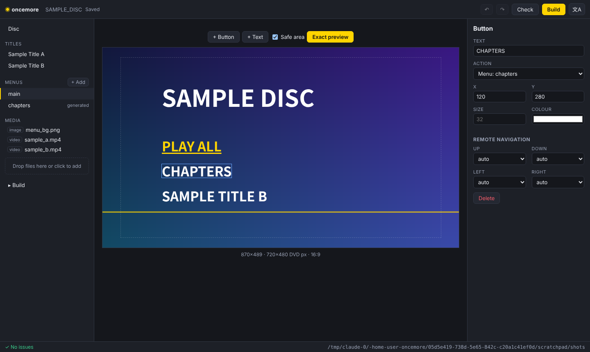
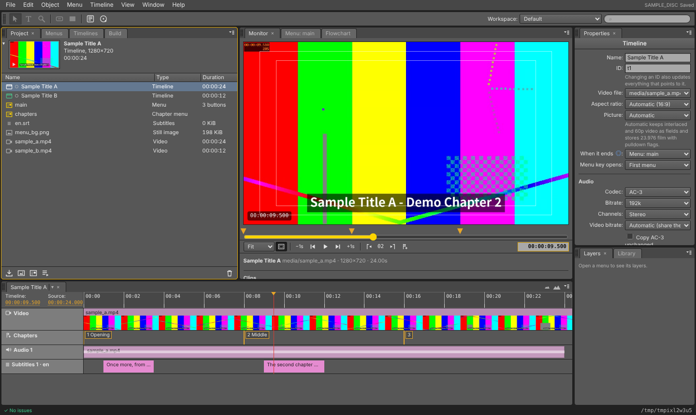
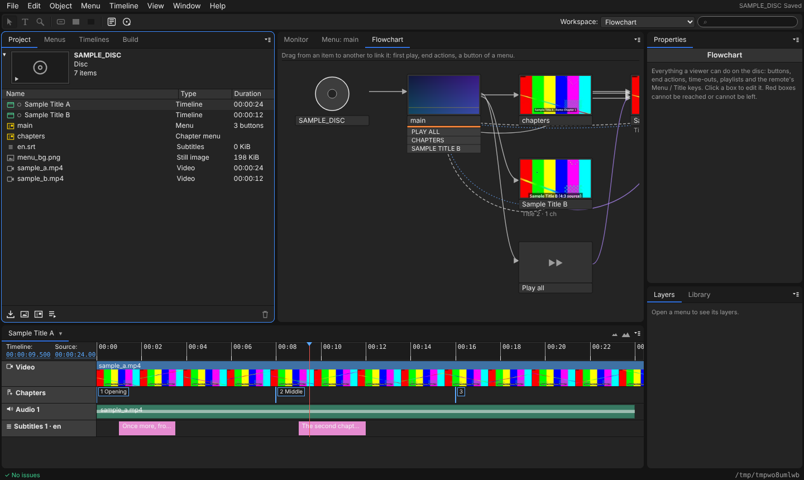
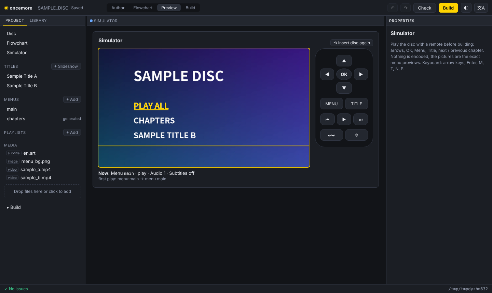

# oncemore

*The DVD authoring app Mac forgot. Menus, chapters, ISO — once more.*

[日本語版 README](README.ja.md)

oncemore turns your video files into a **DVD-Video disc image with real menus**:
a still menu with buttons, an auto-generated chapter menu with thumbnails,
chapter jumps, and "return to the menu when the movie ends". You describe the
disc in one JSON file and get a `.iso` you can play in VLC, burn, or mount.

It comes as an **authoring app that runs in your browser on your own Mac**
(`oncemore gui`), on top of a scriptable command-line core. Nothing is uploaded
anywhere: the app is served from your machine and works on your files.



## What oncemore promises

These are the reasons it exists; the tests and CI guard each of them
(`tests/test_promises.py`), so they cannot quietly go away:

* **A real authoring app on the Mac** — Oncemore.app for Apple silicon and
  Intel, built and smoke-tested on every change.
* **A disc image first** — it writes a standard ISO (UDF + ISO 9660) or a
  VIDEO_TS folder with nothing else installed; burning it to a DVD is an
  optional last step (Build > Output: DVD disc, or `oncemore burn`).
* **Runs in a browser** — the app is a web page served from your own machine,
  so it also works on Linux and needs no installer beyond Python.
* **Open and yours** — GPL-3.0, no account, no network access, no telemetry,
  and no copy protection, ever. Projects are plain JSON.

## Why

Adobe Encore was discontinued in 2012; Apple's DVD Studio Pro and iDVD are gone,
and Final Cut Pro 10.8 removed disc output altogether. DVDStyler's macOS build is
still Intel-only. Meanwhile the codecs DVD-Video requires are patent-free
(MPEG-2 since 2018, AC-3 since 2017), so an open-source authoring tool can do
the whole job. oncemore is that tool — with no copy protection, ever.

## Install

oncemore itself is pure Python (3.11+, standard library only). It drives these
programs:

| Program | Used for |
|---|---|
| `ffmpeg`, `ffprobe` (with the `drawtext` filter) | MPEG-2/AC-3 encoding, menu rendering, probing |
| `dvdauthor`, `spumux` | DVD-Video structure (IFO/VOB), button highlights |
| *(nothing)* — oncemore writes the UDF + ISO 9660 disc image itself; `hdiutil`, `genisoimage`, `mkisofs` can be chosen instead | the disc image |
| *(optional)* `growisofs` (dvd+rw-tools; macOS uses its own `hdiutil`) | burning the disc to a DVD |

### macOS (Homebrew)

```sh
brew install ffmpeg-full dvdauthor
pip install git+https://github.com/kajisho5/oncemore
oncemore doctor
```

* Use **`ffmpeg-full`**, not `ffmpeg`: Homebrew's plain `ffmpeg` formula is built
  without libfreetype, so it has no `drawtext` filter for menu text.
  `ffmpeg-full` is keg-only (not linked into your PATH); oncemore finds it in
  `$(brew --prefix)/opt/ffmpeg-full/bin` automatically.
* The ISO is written by oncemore itself (UDF 1.02 + ISO 9660), so no ISO
  tool is needed; `--iso-tool hdiutil` uses macOS's own instead.

### Debian / Ubuntu

```sh
sudo apt-get install ffmpeg dvdauthor genisoimage
pip install git+https://github.com/kajisho5/oncemore
oncemore doctor
```

You can also run it from a checkout without installing: `python -m oncemore ...`.

Tool locations can be overridden with `ONCEMORE_FFMPEG`, `ONCEMORE_FFPROBE`,
`ONCEMORE_DVDAUTHOR`, `ONCEMORE_SPUMUX`, `ONCEMORE_GENISOIMAGE`,
`ONCEMORE_MKISOFS`, `ONCEMORE_XORRISO`, and the menu font with `ONCEMORE_FONT`.
If something is missing, oncemore says what and prints the install command.

## The Mac app

**Oncemore.app** wraps the same authoring UI in a normal Mac window: double-click
to start, *File › New Project… / Open Project…*, and it reopens your last
project. Python is bundled; only the video tools come from Homebrew:

```sh
brew install ffmpeg-full dvdauthor
```

Download `Oncemore-<version>-arm64.zip` (Apple silicon) or
`Oncemore-<version>-x86_64.zip` (Intel) from the
[Releases](https://github.com/kajisho5/oncemore/releases) page (or the latest CI
run's artifacts), unzip, and move *Oncemore.app* to Applications. The
build is not notarised yet, so macOS blocks the first launch: open *System
Settings › Privacy & Security* and click **Open Anyway** (or run
`xattr -dr com.apple.quarantine /Applications/Oncemore.app`). Build it yourself
with `macos/build_app.sh` (Xcode command line tools + `gh`); with a Developer ID
set `CODESIGN_IDENTITY` and `NOTARIZE=1` to produce a signed, notarised app.
Pushing a tag `v<version>` runs `.github/workflows/release.yml`, which builds
both architectures, launches each on a sample project and attaches the zips to a
draft release (signed and notarised when the signing secrets listed in that file
are set).

## Quick start: the app in a browser

```sh
oncemore gui my-disc          # opens http://127.0.0.1:…/ in your browser
```

* **New project** → *Create sample project* gives you a working disc to explore,
  or start empty and **drop your video files** onto the window.
* **Titles**: pick a video in *Media* → *Add as title*. Scrub through it and
  press **◆ Add chapter here** wherever a chapter should start; **▶ Play** plays
  it (a small preview copy is made the first time). Tick *Generate a
  chapter menu* for a thumbnail menu. Set what happens when it ends, audio
  tracks and subtitles (`.srt`, `.vtt`, `.ass`) in the right-hand panel. Below the
  timeline, **Subtitles** edits the cues (start / end, text, top or bottom):
  *+ Add cue at playhead* times a new one from where you are; files in other
  formats can be saved as a new `.srt` to edit.
* **+ Slideshow** turns the pictures in *Media* into a title: set each picture's
  duration and order, cross-fade or cut, slow zoom (pan & zoom) and music;
  **Render & play** shows it as it will be on the disc. Every picture starts a
  chapter.
* **Clips**: under a title's picture, *Add a clip…* joins more videos and still
  pictures into the same title — parts of files (in / out), in any order, of
  different sizes, frame rates and sound (or none); a picture is shown for the
  seconds you set, whole (fit) or filling the frame (fill). The title then
  shows and plays the joined result, the timeline shows each clip, and every
  clip starts a chapter unless you set chapters yourself.
* **Menus**: *+ Add* starts blank or from a template (classic, banner, minimal,
  setup), then drag buttons, text and rectangles where you want them —
  Shift-click selects several, with align / distribute buttons, snapping guides,
  arrow-key nudging and ⌘D to duplicate. Choose
  each button's target (a menu, a title, a chapter, an audio or subtitle
  stream). A button can be a picture instead of text (*Image*, highlighted by a
  frame or by its shape). Use an image or a video as the background. **Exact preview**
  renders the menu exactly as the disc will show it, with button hit areas.
* ▲/▼ in the right-hand panel change the order of titles and menus.
* **Backups**: before a save replaces the project file, the version it
  replaces is kept in `.oncemore-backup/` next to it (at most every five
  minutes, the last 30). **File > Revert to a saved version** goes back to one
  of them; Undo returns to where you were.
* **Layers**: the eye switches an element off — it stays in the project but is
  not on the disc (a button's routes to it go too).
* **Save menu as template** (Menu menu): the menu and copies of its pictures,
  fonts and music go to your template library (`ONCEMORE_TEMPLATES`, or
  `~/Library/Application Support/oncemore/templates` on a Mac); **My templates**
  in the Library starts a menu from one in any project (links the project does
  not have become *stop*). **Create chapter index** makes a title's chapter menu.
* **Colour set** (menu Properties): Normal (buttons while not selected,
  optional), Highlight and Activated colours, each with an opacity; previews
  and the simulator show them as the player will.
* **Chapter markers from the file**: a video that carries chapter markers
  (MP4, MOV, MKV …) brings them along, names included, when it becomes a
  title; Timeline > Import chapter markers from the source reads them again
  (for titles made of clips, the markers inside each clip).
* **Chapters at intervals** (Timeline menu): a chapter every *n* minutes or
  seconds, replacing the chapters there are or adding to them.
* **Replace asset** (File menu, or right-click a file): every use of one file
  in the project points to another — also how a missing file is found again
  (missing files are listed first, and the issue list offers it).
* **Edit menu in Photoshop** (Edit menu, Tools panel or Properties): opens a
  menu's `.psd`; when it is saved there, the Menu Viewer offers to import it
  again. **File > Project settings** shows the disc's settings; the **Window**
  menu brings any panel to the front.
* **Transcode now**: titles are encoded when the disc is built, or ahead of
  time with *Transcode this title now* / *Transcode all titles now* (right-click
  a title, or the Disc menu); the build then reuses them. A filled dot next to
  a title in the project panel means it is transcoded. The timeline draws each
  sound track's waveform.
* **Linking and routing**: drag a title, menu or playlist from the project
  panel onto a button to link it, or onto an empty part of the menu to add a
  button for it. *Routing* draws where the remote's arrow keys go from each
  button (solid: set by you in Properties, dashed: automatic), exactly as the
  disc will have it.
* **Menus and shortcuts**: the menu bar is laid out the way disc authoring
  people know it — File, Edit, Object, Menu, Timeline, Window, Help (in
  Oncemore.app it is the Mac's own menu bar); right-click a title, menu or
  playlist (open, duplicate, move, play first, transcode, delete), a file in
  *Media* or an element on the menu. Shortcuts: ⌘I import, ⌘B build, ⌘D
  duplicate, ⌘Z / ⇧⌘Z undo / redo, ⌘L link of the selected button, V / T / Z
  selection, text and zoom tools, + / − zoom, `*` (Shift+8) chapter at the
  playhead, PgUp / PgDn previous / next chapter, Space play / pause, ⇧Space
  preview, ⌥⇧1–4 workspaces, ? the list (Ctrl instead of ⌘ on other systems).
* **The menu editor**: a tools strip (selection, text — click where it goes,
  zoom, new button / rectangle, preview) and a viewer bar under the menu: zoom,
  safe area, routing, snapping, and *Highlights: Normal / Selected /
  Activated* showing every button as the disc will in that state. Buttons
  whose areas overlap are outlined in red.
* **Pick whip**: drag the ◎ next to a button's link (or a title's end action,
  or the disc's first play) to a title, menu or playlist in the project panel
  or the flowchart. In the **flowchart**, drag from one item to another to link
  them (first play, end actions, or — after picking it — a menu's button);
  items nothing leads to sit in a "Not used" row at the bottom.
* **Preview** (⇧Space) starts the remote-control preview at the menu you are
  editing; in it, 1–9 press that button, Home is the Title key, Insert the
  Menu key, End plays to the end.
* **Flowchart** shows the whole disc: first play, menus, titles, playlists and
  every link between them (buttons, end actions, time-outs, the remote's Menu
  and Title keys). Boxes a viewer can never reach, or menus they cannot leave,
  are outlined in red; click a box to edit it.
* **Simulator** plays the disc with an on-screen remote (arrows, OK, Menu,
  Title, ⏮ ⏭, play to the end, let a menu time out) before anything is
  encoded: menus are the exact previews with the real highlight, titles show
  the chapter's first frame. It follows the same navigation rules as the
  built disc (checked against libdvdnav in the tests).
* The **Build** panel (next to Project): **Check Project…** estimates the size
  and finds problems; **Build** writes the `.iso` (or a VIDEO_TS folder) into
  `my-disc/output/`, with progress.
* Everything is saved automatically to `my-disc/project.oncemore.json`;
  ⌘Z / Ctrl+Z undoes. The UI follows your browser language (English/日本語;
  Edit > Preferences switches it, sets the brightness and a light theme).



The workspace is the classic disc authoring layout: the menu bar, a **Tools**
panel (selection, text, zoom, new button / rectangle, Photoshop, Preview) with
the **Workspace** menu and a search field; **Project · Menus · Timelines ·
Build** on the left, **Monitor · Menu Viewer · Flowchart** in the middle, the
**Timeline** across the bottom of both, **Properties** and **Library ·
Layers** on the right. Two skins (Edit > Preferences): **Modern**, the
default, and **Classic** — mid-grey panels, light text fields, an amber outline
on the panel you are working in, amber timecode. Panels are resized by dragging
their edges. The design rules are in [docs/DESIGN.md](docs/DESIGN.md) and the
app shows them at `/styleguide.html`.




The app listens on 127.0.0.1 only, with a random per-launch key in the URL;
it reads and writes files only inside the project folder.

## Quick start: the command line

```sh
oncemore init demo                                   # sample project + generated test media
oncemore preview-menu demo --menu main -o main.png   # look at the menu
oncemore iso demo/project.oncemore.json -o demo.iso  # encode, author, write the ISO
```

The sample disc has a main menu (PLAY ALL / CHAPTERS / SAMPLE TITLE B), a
generated chapter menu with thumbnails, a 16:9 title with three chapters and a
4:3 title (pillarboxed). All sample media are synthesised with ffmpeg test
sources — nothing large lives in this repository.

## Commands

```
oncemore init <dir> [--standard NTSC|PAL] [--aspect 16:9|4:3] [--force]
oncemore validate <project> [--no-media]       # schema + references + media + size estimate
oncemore build <project> -o out/               # writes out/VIDEO_TS (and out/AUDIO_TS)
oncemore build <project> -o out/ --format bluray  # writes out/BDMV (Blu-ray, HD)
oncemore iso <project> -o bd.iso --format bluray   # a Blu-ray image (UDF 2.50, built-in writer)
oncemore iso <project> -o out.iso [--iso-tool auto|builtin|hdiutil|genisoimage|mkisofs|xorriso]
oncemore preview-menu <project> --menu main -o main.png [--button id] [--state highlight|select|normal] [--outline]
oncemore simulate <project> --keys down,enter,menu   # press remote keys, no encoding
oncemore import-psd <project> design.psd --menu main [--first-play]   # a menu from Photoshop
oncemore gui [<dir>] [--port N] [--no-browser] # the authoring app
oncemore transcode <project> [--title ID] [--fast] [--status]  # encode titles ahead of the build
oncemore burn out.iso [--device DEV]           # write the image to a blank DVD (macOS: hdiutil, else growisofs)
oncemore doctor                                # external tools, versions, ISO backend
```

* `<project>` is a `project.oncemore.json` file or the directory containing it.
* `validate` also checks the navigation: titles, menus and playlists nothing
  leads to, and menus without a way out, are reported as warnings
  (`navigation` in `--json` output).
* `build` and `iso` encode in **2 passes** by default; `--fast` uses 1 pass.
* Intermediate files go to `out/.work/` (for `iso`: a hidden build directory
  next to the ISO) and are deleted on success unless `--keep-work` is given.
  Every external command's log is in `.work/logs/`.
* `--json` (before or after the command) switches to **JSON Lines** on stdout
  for GUIs and scripts: `step`, `progress` (`fraction` 0–1), `log`, and a final
  `result` or `error` object. Exit codes: 0 ok, 1 error, 2 invalid project,
  3 missing tools, 4 an external tool failed.

## Project file

`project.oncemore.json` is the only input. JSON Schema:
[schema/project.schema.json](schema/project.schema.json). Paths are relative to
the project file. Example: [examples/basic/project.oncemore.json](examples/basic/project.oncemore.json).

```jsonc
{
  "version": 1,
  "disc": {
    "label": "SAMPLE_DISC",      // volume label; normalised to A-Z 0-9 _ (max 32)
    "standard": "NTSC",          // NTSC (720x480, 29.97) | PAL (720x576, 25)
    "aspect": "16:9",            // 4:3 | 16:9
    "target": "DVD5",            // DVD5 (4.37 GiB) | DVD9 (7.95 GiB)
    "first_play": "menu:main",   // menu:<id> | title:<id> | playall; default: first menu
    "font": null,                // font file for menu text; null = auto
    "video_bitrate": "auto"      // "auto" = fit the disc, or e.g. "6M"
  },
  "titles": [
    {
      "id": "t1",
      "name": "Sample Title A",                     // used as chapter-menu heading
      "source": "media/sample_a.mp4",
      "chapters": ["00:00:00", "00:00:08", 16],     // "HH:MM:SS[.ms]", "MM:SS" or seconds
      "audio": { "codec": "ac3", "bitrate": "192k" },// ac3 | lpcm (48 kHz/16-bit); "channels": 6 = 5.1
      "end_action": "menu:main",                    // menu:<id> | title:<id> | stop
      "auto_chapter_menu": { "id": "chapters", "back": "menu:main" }  // or true
    }
  ],
  "menus": [
    {
      "id": "main",
      "background": "media/menu_bg.png",   // still image; null = background_color
      "audio": null,                       // optional looping music
      "texts": [{ "text": "SAMPLE DISC", "x": 120, "y": 90, "size": 56 }],
      "buttons": [
        { "id": "play", "label": "PLAY ALL", "x": 120, "y": 220, "action": "playall" },
        { "id": "ch",   "label": "CHAPTERS", "x": 120, "y": 280, "action": "menu:chapters" }
      ],
      "highlight_color": "#FFD400",
      "select_color": "#FF5A00"
    }
  ]
}
```

### Reference

**disc**

| Key | Type / values | Default |
|---|---|---|
| `label` | string → A–Z 0–9 `_`, ≤ 32 chars | required |
| `standard` | `NTSC` \| `PAL` | required |
| `aspect` | `4:3` \| `16:9` | required |
| `target` | `DVD5` \| `DVD9` | `DVD5` |
| `first_play` | `menu:<id>` \| `title:<id>` \| `playall` | first menu, else first title |
| `title_key` | what the remote's Title / Top Menu key opens: `menu:<id>` \| `title:<id>` \| `playall` | first menu |
| `font` | path or `null` | auto: Hiragino (macOS) → Noto Sans CJK → DejaVu Sans |
| `video_bitrate` | `"auto"` or bitrate (`"6M"`, `5500000`), 1–8 Mbit/s | `auto` |
| `rom_files` | files / folders put next to VIDEO_TS (DVD-ROM content for computers) | none |
| `bluray.target` | `BD25` \| `BD50`: the disc size when the project is built as a Blu-ray | `BD25` |
| `subtitle_style` | `{size, color, outline, outline_width, margin}` for all subtitles | 30 px (PAL 36), white, black outline 3 px, 36 px (PAL 43) from the bottom |

**titles[]** (1–99)

| Key | Type / values | Default |
|---|---|---|
| `id` | `[A-Za-z0-9_-]{1,40}` | required |
| `name` | string | the id |
| `source` | any video ffmpeg reads | required (or `slideshow` / `clips`) |
| `slideshow` | a title made from pictures (below) | none |
| `clips` | a title made of parts of several videos (below) | none |
| `chapters` | list of times, or `{time, name, poster}` objects (`name` labels the chapter-menu button, `poster` is the time of its thumbnail); `0` is added if missing | `[0]` |
| `audio.codec` | `ac3` \| `lpcm` | `ac3` |
| `audio.bitrate` | AC-3 only, 64k–448k | `192k` (`448k` for 5.1) |
| `audio.passthrough` | copy 48 kHz AC-3 from the sources unchanged (channels must match) | `false` |
| `video_bitrate` | this title's own video bitrate; the other titles share the rest | shared |
| `scan` | `auto` \| `progressive` \| `interlaced` \| `pulldown` (NTSC film) \| `ivtc` (NTSC: film already telecined to 29.97i — its film frames are recovered and stored with soft pulldown): how the picture is stored, see Known limitations | `auto` |
| `audio.channels` | `2` (stereo, sources are down-mixed) \| `6` (5.1, AC-3 only) | `2` |
| `end_action` | `menu:<id>` \| `title:<id>` \| `lastmenu` (back to the menu shown last) \| `stop` | first-play menu, else `stop` |
| `remote_menu` | menu the remote's Menu key opens during this title | first menu |
| `aspect` | `4:3` \| `16:9` for this title | `disc.aspect` |
| `audio.lang` | ISO 639-1 code of the (single) audio track | none |
| `audio_tracks` | 1–8 `{source?, stream?, lang?}`: several audio streams (below) | one track from `source` |
| `subtitles` | up to 32 `{file, lang?, default?}` SRT files (below) | none |
| `auto_chapter_menu` | `true` or object (below) | off |

`auto_chapter_menu` object: `id` (default `chapters_<title id>`; extra pages get
`_2`, `_3`…), `title` (heading), `back` (action of the BACK button, default:
the first-play menu), `label_format` (default `"Chapter {n}"`), `back_label`,
`prev_label`, `next_label`, `background`, `background_color`, `text_color`,
`highlight_color`, `select_color`, `normal_color`, `audio`, `duration`, `background_video` (a
motion chapter menu) and `animated_thumbnails` (with a motion background, the
thumbnails play their chapter). Six chapters per page, with PREV/NEXT buttons
when there are more.

**menus[]** (≤ 99)

| Key | Type / values | Default |
|---|---|---|
| `id` | identifier | required |
| `background` | still image or `null` | `null` |
| `background_color` | `#RRGGBB` | `#000000` |
| `background_video` | video file for a **motion menu** (overrides `background`) | `null` |
| `audio` | music file or `null` | the background video's sound, else silence |
| `duration` | loop length, seconds | video / music length (≤ 600), else 5 |
| `loop` | `"forever"` or how many times it plays before `end_action` | `forever` |
| `loop_point` | repeats start here (time); the part before plays once as an intro | `0` |
| `fade_in` | seconds the menu fades in from black (picture and sound), at most 10; played once, repeats start after it | `0` |
| `buttons_at_loop` | the buttons appear (and work) only from the loop point (or the end of the fade-in) on, so the intro plays out | `false` |
| `end_action` | after the last loop: `menu:` \| `title:` \| `chapter:` \| `playall` \| `stop` | `stop` |
| `default_button` | button id highlighted when the menu opens | the first |
| `remember_button` | coming back highlights the button used last (menus 1–7) | `true` |
| `font_size`, `text_color` | defaults for texts/buttons | `32`, `#FFFFFF` |
| `highlight_color`, `select_color` | button colours when selected / activated; `#RRGGBBAA` for translucent (a DVD has 16 levels of opacity) | `#FFD400`, `#FF5A00` |
| `hidden` (buttons, texts, shapes, images) | switched off in the Layers panel: kept in the project, not on the disc | `false` |
| `normal_color` | colour of the buttons' highlight shapes while not selected (the colour set's Normal state); none when absent | — |
| `texts[]` | `{text, x, y, size?, color?}` decorative text, plus the text style keys below | `[]` |
| `shapes[]` | `{x, y, w, h, color}` filled rectangles (bars, panels; `#RRGGBBAA` for translucent) drawn under texts and buttons | `[]` |
| `images[]` | `{file, x, y, w, h, opacity}` pictures that are not buttons (logos, photos; PNG keeps its transparency), drawn over the rectangles and under texts and buttons. In the app: Tools > Picture, or right-click an image > Place on the menu | `[]` |

Text style (texts and text buttons): `font` (a font file for this element; it
must contain all its characters), `outline` + `outline_width`, `shadow` +
`shadow_offset`. A button's `highlight_image` is a picture whose opaque pixels
light up when it is selected, instead of the automatic highlight.
| `buttons[]` | 1–36 buttons | required |

**buttons[]**: `id`, `label`, `x`, `y` (top-left of the label), `action`,
`auto_activate` (run as soon as the button is selected),
(`menu:<id>` \| `title:<id>` \| `chapter:<title id>:<n>` \| `playall` \| `audio:<n>` \|
`subtitle:<n>` \| `subtitle:off` \| `resume` \| `stop`), optional `size`, `color`, and `nav`
(`{"up": id, "down": id, "left": id, "right": id}`) to override the automatic
navigation. `audio:<n>` / `subtitle:<n>` (1-based) select a stream and stay on
the menu, so a "setup" menu is just a few of these buttons plus a BACK button.
`playall` plays every title in project order and then follows the last title's
`end_action`; a title started on its own (by a title or chapter button) still
ends with its own `end_action`. `resume` continues the title the remote's Menu
or Title key interrupted, where it was left; when there is nothing to resume
(at the start of the disc, or after the title ended) it plays the first title.
Wherever an action can open a menu (buttons, end actions, overrides, first
play, the Title key), `menu:<id>:<button id>` opens it with that button
highlighted instead of its default or remembered one, e.g. a BACK button
that returns to the main menu on the button that led away from it, or a
title that ends on the main menu's next episode.
`override` on a `title:` / `chapter:` button (`menu:<id>` \| `title:<id>` \| `stop`)
replaces the end action of the title it plays, for that play only: titles
can chain into each other for "play all" while each song button still
returns to the menu. `audio` (1-based) and `subtitle` (1-based, `0` = off)
on a button switch streams along with its action, e.g. a "play with
commentary" button: `{"action": "title:film", "audio": 2, "subtitle": 0}`.
**Image buttons**: `image` (a picture, transparent PNG works best) replaces the
label (then optional), drawn with its top-left at `x`/`y`; `width` on the
720-wide grid (default: the picture's own width; the height follows its
aspect), and `highlight`: `frame` (default, a frame around it) or `shape` (its
opaque pixels in the highlight colour).

### Menus from Photoshop

Design a menu as a layered `.psd` / `.psb` (RGB, 8 or 16 bits) and bring it in
with **Menus → + Add → Import from Photoshop** (or `oncemore import-psd`). The
layer names use the prefixes long common for DVD menus:

| Layer name | Meaning |
|---|---|
| `(+) Play Movie` | a **group** that is a button; the name becomes its id and suggests its target |
| `(=1) …` inside a button | its highlight (also `(=2)`, `(=3)`; merged, a DVD highlight here has one colour) |
| `(%) …` inside a button | where the title / chapter thumbnail goes |
| anything else visible | artwork, flattened into the background |

* The background is the file's own flattened image when the `(=n)` and `(%)`
  layers are hidden (exact, layer effects included; save with *Maximize
  Compatibility*). Otherwise it is rebuilt from the layers with normal blending.
* Buttons without a `(=1)` layer light up in the shape of their artwork.
* Names such as *Play*, *Play all*, *Scene 3*, a title's name, a menu id,
  *Audio 2* or *Subtitles off* are linked automatically; check the rest.
* A 720 × 480 (576) design is read as DVD pixels, an 854 × 480 or 1024 × 576
  one as square pixels: both land where they were drawn.
* **Import again** after editing the file updates the pictures and keeps every
  button's target and the menu's settings.

Imported buttons are ordinary buttons with only a `highlight_image` (and a
`thumbnail` rectangle, which any title / chapter button can have).

### Playlists

```jsonc
"playlists": [{
  "id": "best", "name": "Best scenes",
  "items": ["t1:2", "t2:2-3", "t1"],   // a chapter, a chapter range, a whole title
  "end_action": "menu:main"            // menu:<id> | title:<id> | lastmenu | stop (default)
}]
```

A button with `"action": "playlist:best"` (or `first_play` / `title_key`) plays the
items in order, also across titles with different formats; an item stops at the
end of its last chapter. Title, chapter and play-all buttons leave playlist mode.

### Slideshows

```jsonc
"titles": [{
  "id": "holiday", "name": "Holiday",
  "slideshow": {
    "slides": [{ "image": "media/beach.jpg", "duration": 6 },   // seconds, default 5
               { "image": "media/hills.png" }],
    "transition": "crossfade",        // or "none" (cuts)
    "transition_duration": 1,         // seconds, shorter than every slide
    "pan_zoom": true,                 // a slow zoom in / out on every picture
    "fit": "fill",                    // fill the frame (edges cropped); default "fit"
    "audio": "media/music.m4a",       // trimmed to the show and faded out
    "background_color": "#000000"     // around pictures of another shape
  },
  "end_action": "menu:main"
}]
```

The pictures are fitted on the disc's square-pixel canvas (854 × 480 for NTSC
16:9) and rendered once into a lossless video in `.oncemore-cache/slideshow`;
that video is then encoded like any other title (and re-rendered only when a
picture, a duration or a setting changes). Slide *k* starts at the sum of the
earlier durations and is a chapter unless `chapters` is given. `fit` decides
what happens to pictures of another shape: `fit` shows all of each with the
background colour around, `fill` fills the frame and crops what is outside;
a slide can have its own `fit`.

### Titles made of clips

```jsonc
"titles": [{
  "id": "evening", "name": "The evening",
  "clips": [
    { "source": "media/arrival.mov", "in": "00:01:10", "out": "00:03:00" },
    { "source": "media/speech.mp4" },                  // the whole file
    { "source": "media/phone.mp4", "out": 42.5 },      // seconds or HH:MM:SS(.mmm)
    { "source": "media/group.jpg", "duration": 6, "fit": "fill" }  // a still picture
  ],
  "end_action": "menu:main"
}]
```

The clips play one after another as one title, joined while the title is
encoded (nothing is rendered beforehand). Each clip is converted to the
disc's format on its own, so sizes, frame rates and sound formats can differ;
a clip without sound gets silence. Clip lengths are rounded up to whole
frames so picture and sound meet at every join. Clip *k* starts a chapter
unless `chapters` is given. All clips 23.976p film keep soft pulldown, all
interlaced stay interlaced; a mix is made progressive. A clip title has one
sound track (`audio_tracks` and `audio.passthrough` are not available).
Menu thumbnails and poster frames pick the clip that plays at that time.

A still picture (`.png`, `.jpg`, `.jpeg`, `.bmp`, `.tif`, `.tiff`, `.webp`) is
shown for its `duration` (default 5 s, 0.5 s to 1 hour; no `in` / `out`) and
is silent. `fit` (default) shows all of it with black bars where its shape
differs from the frame; `fill` fills the frame and crops the edges.

### Audio tracks and subtitles

```jsonc
"titles": [{
  "id": "t1", "source": "media/movie.mp4",
  "audio": { "codec": "ac3", "bitrate": "192k" },          // applies to every track
  "audio_tracks": [
    { "lang": "ja" },                                       // stream 0 of `source`
    { "source": "media/commentary.wav", "lang": "en" },     // another file
    { "stream": 1, "lang": "fr" }                           // 2nd audio stream of `source`
  ],
  "subtitles": [
    { "file": "media/ja.srt", "lang": "ja", "default": true },
    { "file": "media/en.srt", "lang": "en" }
  ]
}]
```

* Tracks are padded with silence / cut to the video length; a missing stream
  is reported by `validate`.
* Stream *n* has one language for the whole disc (DVD stores stream attributes
  per titleset), so `lang` must agree between titles.
* Subtitles are SubRip (`.srt`), WebVTT (`.vtt`) or ASS / SSA (`.ass`, `.ssa`),
  UTF-8 or Shift_JIS. Each cue is drawn with the menu font (white with an
  outline, see `disc.subtitle_style`), reduced to a 4-colour DVD subpicture and
  muxed with spumux; overlapping cues are shortened.
* Placement and colour: a track's `"position": "top"` and `"color": "#FFFF00"`,
  overridden per cue by `{\an8}` (SRT / ASS), `line:0` (WebVTT), an ASS style's
  alignment, `{\c&HBBGGRR&}` or `<font color="#RRGGBB">`. A title can use 16
  subpicture colours in all, about 7 different text colours.
* `"default": true` turns that subtitle stream on when the disc starts
  (players keep the viewer's later choice). Without it subtitles start off.

**Coordinates** are DVD pixels: 720 × 480 (NTSC) or 720 × 576 (PAL), whatever
the aspect ratio. oncemore draws text on a square-pixel canvas and squeezes it,
so lettering is never stretched on 16:9 discs. A button's hit area is computed
from where its label is actually drawn; up/down/left/right moves are computed
from the button positions (with wrap-around within a row/column).

### Blu-ray

The same project builds as a Blu-ray: `oncemore build <project> -o out/
--format bluray` for the BDMV folder, `oncemore iso <project> -o bd.iso
--format bluray` for a disc image, or Format: Blu-ray in the app's Build
panel (image, folder, or the image burned to a blank BD). oncemore writes the
whole BDMV folder itself, and the image with its own UDF 2.50 writer (the
file system of Blu-ray discs: the directory tree is stored twice, in a
metadata file and its mirror):

* every title in HD (1920×1080, H.264 with x264's Blu-ray settings; film at
  23.976p, NTSC video as 29.97 and PAL as 25 frames per second in a 1080i
  stream), with its audio tracks (AC-3 or LPCM) and their languages;
* chapters on frames made key frames, so they start exactly there;
* first play, each title's end action when it starts another title, the
  project's playlists (chapter ranges included) and Play All as Blu-ray
  playlists, and the Top Menu key starting `disc.title_key`;
* subtitles as Blu-ray PGS streams: the same tracks, cues, colours and
  positions as on the DVD, drawn for the HD frame with smooth edges (64
  shades instead of a DVD's 4); the track marked `default` is shown from
  the start. A cue ends 0.2 s before the next one begins, which players
  need to decode it;
* menus: every menu, drawn exactly as for the DVD at HD size (texts,
  pictures, thumbnails, chapter menus, PSD artwork), with its buttons as a
  Blu-ray interactive menu: the same highlights in full colour, the same
  routing, links to titles, chapters, playlists, Play All and other menus,
  stream changes, Resume, and the remote's Top Menu key. Still menus hold
  their picture; menus with motion or music repeat (from the loop point);
* `disc.bluray.target` (`BD25` or `BD50`) caps the video rate so the
  titles always fit.

The tests read every Blu-ray back with libbluray, the library VLC, mpv and
Kodi play Blu-ray with: titles, lengths, chapters, streams, first play
through the title end actions, and menus driven with the remote's keys
(which button lights up in which colour, where each key goes); images are
also read file by file with libudfread.

## How it works

```
sources ─ffprobe─▶ plan bitrate ─ffmpeg (2-pass MPEG-2 + AC-3/LPCM)─▶ titles/*.mpg
menu JSON ─ffmpeg drawtext─▶ base.png ─▶ menu.mpg ─spumux (4-colour PNG highlights)─▶ menu.mpg
dvdauthor XML ─dvdauthor─▶ VIDEO_TS ─built-in UDF + ISO 9660 writer─▶ disc.iso
```

* **Bitrate**: from the total title length, the audio bitrates, a menu
  allowance and 2 % safety margin, capped at 8 Mbit/s video and 9.8 Mbit/s total.
* **Picture**: scaled and letter-/pillarboxed into 720×480/576, converted to
  29.97 or 25 fps, DAR flagged as 4:3 or 16:9, BT.601 colour.
* **Chapters** are frame-accurate: key frames are forced at chapter points and
  the GOPs before them are planned so each chapter starts its own VOBU (DVD
  requires VOBUs of at least 0.4 s; dvdauthor would otherwise merge a short GOP
  and move the chapter up to half a second early).
* **Menus** all live in one titleset; buttons jump straight to menus, titles and
  chapters. A title can only *call* its titleset's root menu, so returning to
  another menu goes through the root menu with the target number in GPRM `g1`.
* **Titlesets**: DVD stores one video/audio format per titleset, so titles are
  grouped by (aspect, audio codec) automatically; a 4:3 LPCM title next to 16:9
  AC-3 ones simply lands in titleset 2. Menus stay in titleset 1, jumps across
  titlesets use dvdauthor jumppads, and a title in another titleset returns to
  a menu through the VMGM top menu (dvdauthor then notes "creating a dummy
  menu" for that titleset, which is expected).
* **Highlights** are 2-bit indexed PNGs written by oncemore's own encoder
  (`zlib` + `struct`), handed to spumux.

## Checking the result

Automated: `python -m unittest` runs unit tests and, when the tools are
present, end-to-end tests that build the sample ISO, inspect it with ffprobe /
xorriso, and **press the menu buttons through libdvdnav** (the navigation
library VLC uses) to check chapter jumps and returns to the menu.

By hand:

* **VLC** — `vlc dvd:///path/to/demo.iso`. Menus, button navigation, chapter
  jumps and the return to the menu work (checked with VLC 3.0.20 on Linux by
  driving the remote-control keys). Opening the `.iso` from VLC's GUI should
  behave the same but has not been checked on macOS yet.
* **mpv** — `mpv dvd://0 --dvd-device=demo.iso` plays title 1 (`dvd://1` is
  title 2). mpv **does not support DVD menus** (stated in its manual), so use it
  only to check the titles. When a title ends, mpv follows the disc program into
  the menu and keeps looping it without buttons — press `q`.
* **macOS DVD Player** — double-click the ISO to mount it, then in DVD Player
  choose *File → Open DVD Media…* and select the mounted `VIDEO_TS` folder
  (Apple documents opening VIDEO_TS folders for DVD Player 6.0 on macOS 26).
  Not yet verified by the authors with oncemore output — reports welcome.
* **Burning** — `oncemore burn demo.iso` (or Build > Output: DVD disc) runs
  `hdiutil burn` on macOS and `growisofs -dvd-compat` on Linux; any other
  burning tool works on the ISO as well.

## Rebuilding is fast

Encoded titles and menus are kept in `<project>/.oncemore-cache/encode`, keyed
by their sources (path, size, modification time), settings, bitrate, the ffmpeg
version and oncemore's own encoding code. A rebuild after a menu tweak only
renders that menu. Use `--no-cache` (or *Encode everything again* in the app)
to ignore it, and delete the folder to reclaim the space.

## Known limitations

* Motion menus loop one video (with an optional intro); only chapter thumbnails
  animate, and there are no transitions between menus.
* Audio is stereo or 5.1 (AC-3), re-encoded unless `audio.passthrough` copies
  48 kHz AC-3 sources.
  Subtitles: one font and size per disc, lines centred at the top or bottom
  (no free positioning); at most 16 subpicture colours per title.
* Audio/subtitle stream *n* has one language for the whole disc. Menus have
  one aspect ratio (`disc.aspect`); titles may differ.
* Frame rates: 23.976p film on NTSC gets soft 3:2 pulldown; interlaced
  sources at the disc's rate and 59.94p / 50p sources are stored as fields
  (`scan`). Other rates (e.g. 25 fps on NTSC, 24 / 23.976 on PAL) are
  converted by dropping or repeating frames. Film that was already telecined
  to 29.97i is not detected by itself: choose `scan: ivtc` (Picture:
  Telecined film) to recover its film frames.
* `xorriso` cannot write UDF; images made with it are ISO 9660 only and are
  **not** opened by libdvdread-based players (VLC, mpv) or most DVD players.
  It is only used when chosen with `--iso-tool xorriso`, with a warning.
* The built-in ISO writer lays the disc out like genisoimage `-dvd-video
  -udf` (same sector for every file on the test discs, files placed where
  the IFOs say, UDF 1.02 + ISO 9660 bridge). It keeps one timestamp for the
  whole disc, not each file's.
* Highlights are hard-edged (2-bit subpictures); labels use one font per disc.
  Every character must exist in that font (drawtext has no fallback); oncemore
  checks the font's character map and stops instead of drawing empty boxes.
  Emoji are not supported.
* With `hdiutil` images, libdvdnav-based players (e.g. VLC) show no disc
  *title metadata*: libdvdnav reads the title raw from sector 32, where real
  DVDs and genisoimage keep the UDF volume descriptor, and hdiutil puts it
  elsewhere. The UDF and ISO 9660 volume names themselves are correct
  (checked by the tests); playback is unaffected.
* Blu-ray menus repeat until a button is pressed (no loop count or end
  action after the last loop), end-action overrides are DVD-only, and the
  Menu key during a title opens the top menu (no menu per title); the
  build lists what a project uses of these. 4:3 titles and menus are
  pillarboxed in the 16:9 HD frame. Burning a BD uses the same tools as a DVD; growisofs
  documents BD media, `hdiutil burn` with a BD writer has not been tried.
* No copy protection (by design, permanently).

## License

GPL-3.0-or-later (see [LICENSE](LICENSE)), matching dvdauthor's GPL.
"Encore" and "Adobe" are trademarks of their owners; oncemore is not affiliated
with Adobe.
